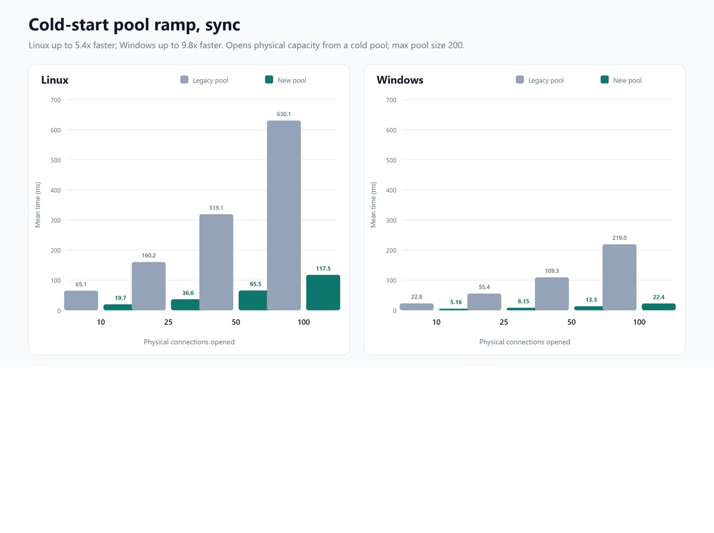
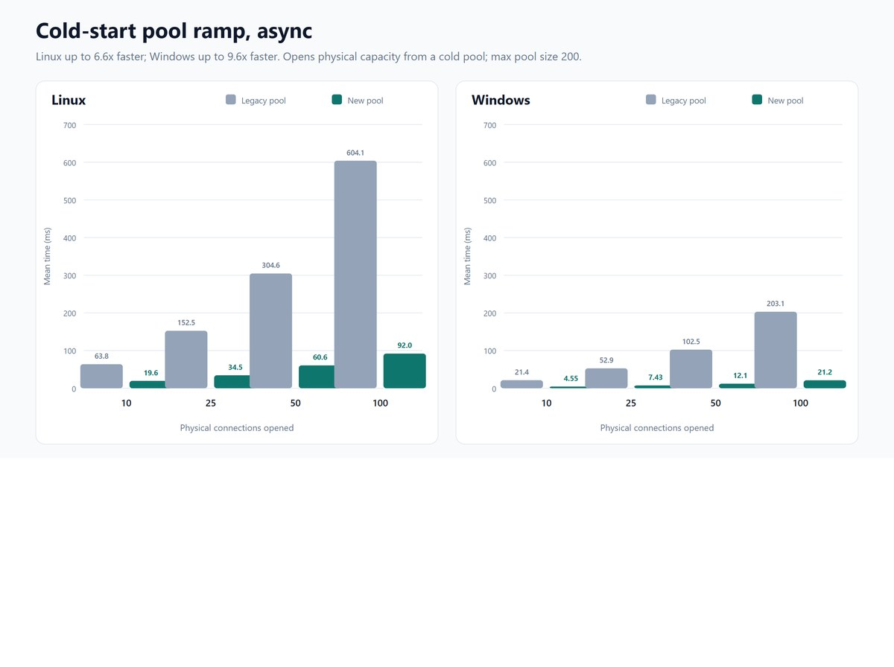

应用启动时并发拉起几十个数据库连接，这件事在旧连接池下有一个硬限制：**一个池同一时刻只允许新建一条物理连接。** 后面排队的调用只能等前面那条建完。启动阶段要读一堆元数据、或者从低谷期突然来一波流量时，这段等待会直接变成对外可见的延迟。

微软 Azure SQL 团队在 2026 年 10 月发布的[原文](https://devblogs.microsoft.com/azure-sql/try-sqlclients-new-connection-pool-for-faster-parallel-connections/)介绍了 `Microsoft.Data.SqlClient` 的新连接池 Pool V2：它允许多条新连接并发建立，并给出了冷启动基准数据——Linux 上 100 并发调用者的平均耗时从 630.1 ms 降到 117.5 ms。启用方式只有一行开关代码。

这篇在原文基础上补三块内容：完整的 10/25/50/100 并发数据表、原文只写了一句但值得展开的线程池风险，以及一个能照着做的验证方案。所有易变动的信息都按当前官方文档核对过。

## 旧连接池到底卡在哪

原文把它概括为「within a pool, only one new connection can be opened at a time」。这句话没有修饰成分，就是字面意思。

连接池的存在意义是复用已认证的物理连接，这部分一直是并行的：池里有多少空闲连接，就能同时满足多少个 `Open()`。受限的是**扩池**这一步。池空了、或者空闲连接不够时，驱动需要新建物理连接，而这要走完整的网络往返和登录认证——DNS 解析、TCP 连接、TLS 握手、登录、认证，每一步都有真实延迟。旧实现一次只放行一条，等于把 N 倍的建连时间串起来。

社区里常见的两种绕法因此流行起来：

- **把 `Min Pool Size` 调大**，启动时就预建好一批连接，避免运行时扩池。代价是这些连接在空闲期也保持打开，白占数据库会话配额，并且在 Azure SQL 无服务器这类会自动暂停的形态里，反而会阻止缩容。
- **干脆关掉连接池**，让应用自己管连接。这等于放弃了复用带来的一切好处。

Pool V2 的目标就是让这两种绕法变得不必要。

## Pool V2 换了什么设计

原文给了两个设计要点。

第一个是**并发建连**，也就是这一版的核心行为改动：池可以在同一时刻建立多条物理连接，而不是排队串行。

第二个是**用 `System.Threading.Channels` 替代专用后台线程**。`Channels` 是 .NET 里的生产者—消费者数据结构，原生支持异步。旧池为每个池维护专用的工作线程来处理唤醒和调度，如果应用连了很多个不同的数据库（每个连接串是一个独立的池），这些线程的开销会累积。基于 Channel 的实现不依赖专用线程，因此在「多池」场景下能减少线程管理开销。原文明确感谢 Npgsql 团队先走通了这条路。

这里值得区分一下语义：**Pool V2 提速的是连接建立阶段，不是查询执行阶段。** 那 630 ms → 117.5 ms 的对比里，不包含任何 SQL 查询时间，也不包含「池已经预热后复用连接」的路径。如果你的瓶颈在慢查询或锁等待，换连接池不会有任何改善。

## 冷启动基准数据

原文的测试方法是：清空连接池，让多个并发调用者同时打开并一直持有连接，直到所有打开操作完成，测量这个完整过程的平均耗时。计时包含连接创建、同步等待和归还，不包含清池和测试准备。这个口径衡量的是**整批建连的总时间**，不是单条连接延迟。

测试条件是 `Max Pool Size=200`，SQL Server 与压测程序跑在同一台机器上以排除网络波动。

### 原文给出的两个头条数字

- **同步、Linux、100 并发**：630.1 ms → 117.5 ms，5.4 倍
- **异步、Linux、100 并发**：604.1 ms → 92.0 ms，6.6 倍

这两个是原文正文里唯一给到具体毫秒数的场景，其余数字都在两张图表里。

### 图表里的完整数据

两张图的坐标轴数据可以从原文 SVG 里读出来。同步（`SqlConnection.Open()`，每个调用者占一个专用线程）：

| 并发调用者 | Linux 旧池 | Linux Pool V2 | Windows 旧池 | Windows Pool V2 |
| ---------- | ---------- | ------------- | ------------ | --------------- |
| 10         | 65.1 ms    | 19.7 ms       | 22.8 ms      | 5.16 ms         |
| 25         | 160.2 ms   | 36.6 ms       | 55.4 ms      | 8.15 ms         |
| 50         | 319.1 ms   | 65.5 ms       | 109.3 ms     | 13.3 ms         |
| 100        | 630.1 ms   | 117.5 ms      | 219.0 ms     | 22.4 ms         |

异步（`SqlConnection.OpenAsync()`）：

| 并发调用者 | Linux 旧池 | Linux Pool V2 | Windows 旧池 | Windows Pool V2 |
| ---------- | ---------- | ------------- | ------------ | --------------- |
| 10         | 63.8 ms    | 19.6 ms       | 21.4 ms      | 4.55 ms         |
| 25         | 152.5 ms   | 34.5 ms       | 52.9 ms      | 7.43 ms         |
| 50         | 304.6 ms   | 60.6 ms       | 102.5 ms     | 12.1 ms         |
| 100        | 604.1 ms   | 92.0 ms       | 203.1 ms     | 21.2 ms         |

图表的副标题给出的整体结论是：同步场景 Linux 最高 5.4 倍、Windows 最高 9.8 倍；异步场景 Linux 最高 6.6 倍、Windows 最高 9.6 倍。





### 怎么读这组数字

原文明说的限制是「Results will vary based on workload and network latency」，来源是官方 GitHub 仓库。这里补三点自己的观察，依据都在上表里。

**第一，提速幅度在低并发下就已经出现，不是只在 100 并发才有效。** 原文引用的是 100 并发那一档，因为绝对值最悬殊。但 Linux 同步在 10 并发时是 65.1 ms → 19.7 ms，也是约 3.3 倍；25、50、100 并发分别约 4.4、4.9、5.4 倍。也就是说 5 倍不是极端值，中低并发下同样成立。

**第二，绝对数字的差别很大一部分来自测试环境不一致，不能横向读。** 原文自己的测试环境说明里，Linux 是 SQL Server 2022 Developer CU26，Windows 是 SQL Server 2025 Enterprise Evaluation RTM；`.NET 9.0.19`、`BenchmarkDotNet 0.15.8`、16 核 32 逻辑 CPU 的 Xeon Platinum 8168 则相同。原文评论区里有人直接质疑过这一点，指出两个平台的差异可能来自 SQL Server 版本和版本号，而非操作系统本身。原文没有回应。所以「Linux 比 Windows 慢 4 到 5 倍」不是这份数据能支持的结论。

**第三，同一平台内的相对提速是这份数据里最可信的部分。** 因为旧池和 Pool V2 在完全相同的机器、SQL Server 和并发设置下对比，只有实现不同。Windows 上 219.0 ms → 22.4 ms 的 9.8 倍也属于同一类对比。

顺带一提，测试跑在 .NET 9.0.19 上，而当前版本已经是 .NET 10，评论区有两条留言都在问为什么不用 .NET 10。原文同样没有回应。这不影响结论方向，只是说明数据的时间点。

## 当前版本的已知限制

原文专门用一节讲「异步 I/O 限制」，这一节比它的标题看起来更重要。

**`SqlConnection.OpenAsync()` 还没有一路异步到每一次网络调用。** Pool V2 目前是把工作项投递到托管线程池的线程上，由这些线程执行同步网络调用。正常情况下这没问题，但如果建连的网络延迟很高，托管线程池会承受额外压力；线程不够用时要等运行时补线程，而补线程本身有延迟，这段延迟就转嫁成了用户可见的耗时。

原文给出的应对建议是：**对 SQL Server 延迟较高的应用，应该监控托管线程池压力，必要时增大线程池下限，或者对数据库操作施加并发上限。** 原文也承诺后续版本会修正这些网络调用，去掉这层额外压力。

这里的取舍很清楚：Pool V2 换来的是建连吞吐，付出的代价是当网络 RTT 很高时，可能会把连接池的问题转换成线程池的问题。如果你连的是同机或同区域的 SQL Server，这个风险基本可以忽略；如果客户端到数据库跨地域、或者经过高延迟链路，就不该直接上生产。

原文还提到一个过渡期的风险，容易被漏掉：Pool V2 是新增的可选实现，官方口径是「在评估中」，默认关闭，未来版本才会变成默认。

## 怎么启用和回滚

Pool V2 从 `Microsoft.Data.SqlClient` 7.1.0 开始提供。该版本是 2026 年 9 月 17 日的正式发布版（GA），不是预览版。

启用只需要一行，放在应用程序入口的最前面：

```csharp
AppContext.SetSwitch(
    "Switch.Microsoft.Data.SqlClient.UseConnectionPoolV2",
    true
);
```

在 ASP.NET Core 里，位置要在创建 `WebApplicationBuilder` 之前：

```csharp
AppContext.SetSwitch(
    "Switch.Microsoft.Data.SqlClient.UseConnectionPoolV2",
    true
);

var builder = WebApplication.CreateBuilder(args);
builder.Services.AddDbContext<AppDbContext>(options =>
    options.UseSqlServer(builder.Configuration.GetConnectionString("Default"))
);
```

原文说「这是唯一需要的代码改动，连接串和数据库访问代码都不用动」，这一点成立，连接池相关的连接串选项对两个实现都适用，EF Core、Dapper 以及其他基于 `Microsoft.Data.SqlClient` 的库都跟着生效。

### 三个容易踩的前置条件

**第一，开关必须在任何 SqlClient 类型被使用之前设置。** 官方文档写得很明确：SqlClient 在第一次用到某个开关时会读取并缓存它的值，之后再改没有任何效果。把这段代码写在某个 service 注册之后、或者写在 Program.cs 中间，而前面已经有代码碰过 `SqlConnection`，开关就白设了。放在入口第一行是最省心的做法。

**第二，连接串里的超时预算在 7.1 有一个单独开关。** 官方在 7.1 新增了 `Switch.Microsoft.Data.SqlClient.UseOverallConnectTimeoutForPoolWait`，作用是让「等池里的连接」和「建网络连接」共用同一个 `Connect Timeout` 预算。它的默认值是 `false`，也就是说默认行为仍然是两段各拿一份完整超时，`Open` 的总耗时可能超过你配置的 `Connect Timeout`。这一点原文没有提。池争用严重的场景如果希望超时按直觉生效，需要显式打开它；打开后在高争用下可能比以前更早报超时，属于需要一起测的改动。

**第三，Pool V2 的完整功能在 7.1 才补齐。** 7.1 的发布说明列出了这一版为 Pool V2 补上的能力：事务支持、损坏连接替换、按 `Min Pool Size` 的预热和补充、基于 `Connection Idle Timeout` 的空闲裁剪、可选的建连速率限制、泄漏连接回收，以及性能计数器和 EventSource 追踪的对齐。`ClearPool` 和 `ClearAllPools` 在 Pool V2 下也能正常工作。如果你在更早的版本上试过 Pool V2 并遇到问题，值得按 7.1.0 重新评估一次。

回滚就是把 `true` 改成 `false` 然后重启进程——连接池是进程内的，没有需要清理的外部状态。

## 一份可以照着做的验证方案

官方建议在应用启动、低谷后流量突增、连接并发需求高、以及对 SQL Server 延迟较高这四类场景下用有代表性的负载评估 Pool V2。这四类场景的共性是需要**新建物理连接**。下面是一个可以直接落地的验证步骤。

**第一步，构造冷启动场景。** 冷启动的定义是池为空时同时申请 N 条连接。最直接的做法是在测试环境重启应用进程，或者调用 `SqlConnection.ClearAllPools()` 把池清空后再施压。注意 `ClearAllPools` 只用于测试，官方明确说不要把它当定期维护手段。

**第二步，埋两个时间点。** 计时口径要和原文一致，量的是「整批建连完成的总时间」，所以应该在所有并发任务开始时打一个时间戳，在最后一个 `OpenAsync()` 返回时收尾。单条连接的耗时在这个场景里没有意义。

**第三步，同时盯住线程池。** 这是原文没给方法的部分。托管线程池的压力可以通过运行时事件计数器观察，`System.Runtime` 事件源下的 `threadpool-thread-count`、`threadpool-queue-length` 是常用指标；也可以在压测期间周期性读取 `ThreadPool.ThreadCount` 和 `ThreadPool.PendingWorkItemCount`。判据是：**如果建连耗时下降了，但线程池队列长度上升、线程数持续被拉起，就说明限制已经换了个位置。** 这种情况下按原文建议调大线程池下限，或者对数据库操作加并发闸门，再测一轮。

**第四步，比较同口径数据。** 用同一个进程、同一份负载、同一个并发数跑两遍，只改那一个开关。上表的结论是相对提速在 3 到 10 倍之间，如果你的测量结果是接近 1，说明瓶颈不在建连。

**第五步，回归热池路径。** 7.1 的发布说明里提到修复了 Pool V2 在「获取已入池连接」路径上的若干性能与分配回归（原本会先走线程池派发、提前分配定时器和 `Task`）。修复是在 7.1 完成的，所以要在 7.1.0 及以上版本做这项回归，重点看稳态吞吐和分配量有没有变化——Pool V2 的收益在冷启动，但代价不该出现在热路径上。

## 适合谁现在就试

按当前信息可以下一个判断：

- **值得试**：应用启动时要建一批连接、或者流量会在低谷后突增、又或者连的是多个不同数据库（多池会让旧池的线程开销更明显）。这类应用开一个开关跑一轮对比，成本很低。
- **需要先测线程池**：客户端到 SQL Server 的网络延迟高。这是 Pool V2 目前最明确的已知副作用，别跳过第三步。
- **暂时不必动**：瓶颈在慢查询、锁等待或连接泄漏。这些和连接池实现无关，换个池不会有改善，应该先看诊断计数器里的 `hard connects`、`stasis connections` 和池超时。

官方计划在未来的 `Microsoft.Data.SqlClient` 版本把 Pool V2 设为默认。在那之前，这是一个默认关闭、可以随时回退的评估项——评估结果可以通过 [dotnet/SqlClient Issues](https://github.com/dotnet/SqlClient/issues) 反馈给驱动团队。

## 参考

- [Try SqlClient's new connection pool for faster parallel connections（原文）](https://devblogs.microsoft.com/azure-sql/try-sqlclients-new-connection-pool-for-faster-parallel-connections/)
- [SQL Server connection pooling with Microsoft.Data.SqlClient](https://learn.microsoft.com/en-us/sql/connect/ado-net/sql-server-connection-pooling)
- [AppContext switches in SqlClient（含 Enable the V2 connection pool）](https://learn.microsoft.com/en-us/sql/connect/ado-net/appcontext-switches)
- [Microsoft.Data.SqlClient 7.1.0 release notes](https://github.com/dotnet/SqlClient/blob/main/release-notes/7.1/7.1.0.md)
- [ChannelDbConnectionPool 实现](https://github.com/dotnet/SqlClient/blob/main/src/Microsoft.Data.SqlClient/src/Microsoft/Data/SqlClient/ConnectionPool/ChannelDbConnectionPool.cs)
- [冷启动基准测试 ConnectionPoolRampRunner](https://github.com/dotnet/SqlClient/blob/main/src/Microsoft.Data.SqlClient/tests/PerformanceTests/BenchmarkRunners/ConnectionPoolRampRunner.cs)
- [dotnet/SqlClient 仓库](https://github.com/dotnet/SqlClient)
