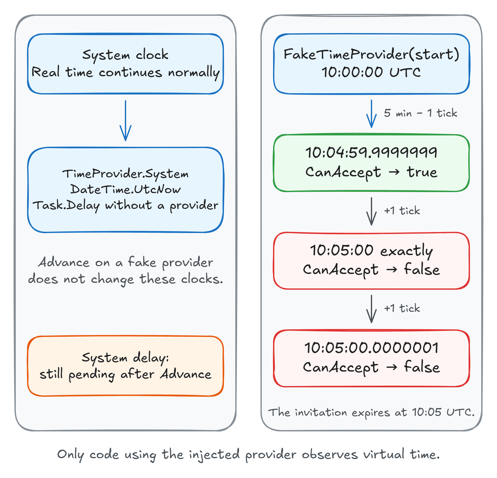

「邀请链接五分钟后过期」这条规则只有一句话，测试它却有两个绕不开的麻烦：真等五分钟不行，把过期时间改成几毫秒又变成看 CI 机器的心情。更麻烦的是那个最容易漏掉的时刻——**正好到达过期时间的那一瞬间**，链接到底还能不能用。

Milan Jovanović 在[原文](https://milanjovanovic.tech/blog/test-time-dependent-code-without-waiting)里给出的做法是：不要让代码去读系统时钟，而是把时钟作为依赖传进去，测试时换成一个可以被代码推动的假时钟。这个抽象就是 .NET 8 起内置的 `TimeProvider`，测试用的实现是 `FakeTimeProvider`。

这篇按「读时间」「等时间」「超时取消」三类场景重新组织原文，并补上原文没有展开的几点：`FakeTimeProvider` 的默认起始时间与 `SetUtcNow`、当前 NuGet 包版本与目标框架、xUnit v2 里必须清空 `SynchronizationContext` 的坑，以及一个可以直接照抄的自检清单。

## 把时钟变成依赖

邀请过期判断本质上是一次时间比较。给策略对象一个 `TimeProvider`，测试就获得了定义「现在几点」的权力。

```csharp
public sealed class InvitationPolicy(TimeProvider clock)
{
    public bool CanAccept(DateTimeOffset expiresAt) =>
        clock.GetUtcNow() < expiresAt;
}
```

注意这里用的是 `<`：到达 `expiresAt` 的那一刻就算过期。改成 `<=` 会让链接多活一瞬间，而这正是后面那个边界测试要挡住的行为改变。

生产环境仍然需要真实时钟，在 `Program.cs` 里注册系统实现即可：

```csharp
builder.Services.AddSingleton(TimeProvider.System);
builder.Services.AddSingleton<InvitationPolicy>();
```

之后 handler 注入 `InvitationPolicy`，把数据库里的过期时间传进来。这段逻辑只负责过期判断，授权和防止同一邀请被重复接受仍要另外处理。

如果这条规则本来就在领域实体里，更省事的做法是让实体方法接收一个 `DateTimeOffset` 参数，由调用方传入当前时间。不是每个实体都需要一个时钟服务。

## 测试精确的过期边界

给测试项目加包。当前稳定版是 **10.10.0**（2026 年 9 月 9 日发布），同时支持 `net8.0`、`net9.0`、`net10.0` 和 `net462`：

```bash
dotnet add package Microsoft.Extensions.TimeProvider.Testing
```

`FakeTimeProvider` 位于 `Microsoft.Extensions.Time.Testing` 命名空间。下面这个测试把「差一个 tick」「正好到点」「过点一个 tick」三种情况连起来断言：

```csharp
using Microsoft.Extensions.Time.Testing;
using Xunit;

public sealed class ClockTests
{
    [Fact]
    public void Invitation_expires_at_the_boundary()
    {
        var start = new DateTimeOffset(2026, 9, 26, 10, 0, 0, TimeSpan.Zero);
        var clock = new FakeTimeProvider(start);
        var policy = new InvitationPolicy(clock);
        var expiresAt = start.AddMinutes(5);

        clock.Advance(TimeSpan.FromMinutes(5) - TimeSpan.FromTicks(1));
        Assert.True(policy.CanAccept(expiresAt));

        clock.Advance(TimeSpan.FromTicks(1));
        Assert.False(policy.CanAccept(expiresAt));

        clock.Advance(TimeSpan.FromTicks(1));
        Assert.False(policy.CanAccept(expiresAt));
    }
}
```

`Advance` 只是把假时钟向前推，不动你机器的系统时间；推完之后它会停在那一点，直到你再次推动，所以再慢的 CI runner 也不会改变这些断言看到的时间。每个测试用自己新建的实例，并行执行时互不干扰。

把策略里的 `<` 换成 `<=`，中间那条断言就会失败，而它前后的断言依然通过。**只测试过期前和过期后，是抓不到这个 bug 的。**



## 等时间：让延迟立刻完成

前面测的是「读时间」。如果代码在失败后要等五分钟再重试，写的是 `Task.Delay(TimeSpan.FromMinutes(5))`，这段等待用的仍然是真实时间——你推假时钟对它没有任何影响，因为它压根没看这个时钟。

把 `clock` 传给 `Task.Delay` 才能接管这次等待：

```csharp
[Fact]
public async Task Delay_completes_when_time_advances()
{
    var clock = new FakeTimeProvider();
    Task delay = Task.Delay(TimeSpan.FromMinutes(5), clock);
    Assert.False(delay.IsCompleted);

    clock.Advance(TimeSpan.FromMinutes(5));
    await delay.WaitAsync(TimeSpan.FromSeconds(5));
}
```

第一条断言确认延迟还没完成；把假时钟推五分钟，它立刻完成，测试不需要真的等那五分钟。

末尾的 `WaitAsync` 不会再加五秒延迟。它是一个真实时间上限：万一你忘了把 `clock` 传给 `Task.Delay`，测试会在五秒后失败，而不是干等五分钟——这是这类测试的兜底保护。

有两个顺序细节值得记住：

- **先创建延迟，再推时钟。** 顺序反了就还没有定时器可完成。
- **重试循环里，每次推完要等下一轮延迟排上再推。** 一次大幅度的 `Advance` 不一定能跑完整个循环。

如果延迟断言偶发失败，检查一下是不是在 `Advance` 之后立刻断言了任务状态。`Advance` 会同步触发定时器回调，但 `Task.Delay` 延续到 `await` 之后的代码未必立刻执行完，用 `await delay.WaitAsync(超时)` 或显式等待比直接读 `Task.Status` 稳。

## 超时取消：确认工作真的停了

再假设一个操作有一分钟超时。你不仅要确认「超时后会取消」，还要确认等待的工作确实停下来了。`CancellationTokenSource` 有一个接受 `TimeProvider` 的构造函数重载，正好用来测这个：

```csharp
[Fact]
public async Task Timeout_cancels_pending_work()
{
    var clock = new FakeTimeProvider();
    using var timeout = new CancellationTokenSource(
        TimeSpan.FromMinutes(1), clock);
    Task work = Task.Delay(
        TimeSpan.FromHours(1), clock, timeout.Token);

    clock.Advance(TimeSpan.FromMinutes(1) - TimeSpan.FromTicks(1));
    Assert.False(timeout.IsCancellationRequested);
    Assert.False(work.IsCompleted);

    clock.Advance(TimeSpan.FromTicks(1));
    await Assert.ThrowsAnyAsync<OperationCanceledException>(
        () => work.WaitAsync(TimeSpan.FromSeconds(5)));
}
```

把 `clock` 从超时构造里拿掉，或者把 `timeout.Token` 从延迟里拿掉，两种改法都会让操作继续等待，测试就会在五秒上限处失败。这正是它作为回归测试的价值：**同一个时钟必须贯穿超时和等待两侧**，任何一侧漏传都会被测出来。

取消是协作式的：HTTP 客户端或数据库驱动必须自己去观察这个 token，取消才会真正中断底层 I/O。建议再补一个测试，断言超时后 handler 返回什么给调用方。

## 原文没提但会绊住你的三件事

**第一，`FakeTimeProvider` 的默认起始时间是 2000 年 1 月 1 日 UTC 午夜**，不是「现在」。如果你直接 `new FakeTimeProvider()` 就去断言某个真实日期，结果会很困惑。除了构造函数传入起始时间，还可以随时用 `SetUtcNow` 跳到任意时刻，或用 `AutoAdvanceAmount` 让每次读时间都自动前进固定量。

**第二，它不会改变 `DateTime.UtcNow`。** 假时钟只作用于通过这个 provider 读时间或排定时器的代码。任何直接调用 `DateTime.UtcNow`、或没传 provider 的 `Task.Delay` 的地方，读到的仍然是真实时间。所以「部分改完」比「完全没改」更隐蔽：你以为测试在控制时间，实际上有一条代码路径还在看真实时钟。

**第三，xUnit v2 需要清空 `SynchronizationContext`。** xUnit v2 会为测试安装自己的 `SynchronizationContext`，当被测代码里混用 `ConfigureAwait(false)` 和 `FakeTimeProvider` 时，延续可能丢失，测试直接卡住不返回，无论测试方法本身是不是 `async`。官方 README 给的办法是在这类测试开头加一行：

```csharp
SynchronizationContext.SetSynchronizationContext(null);
```

xUnit v3 移除了 `AsyncTestSyncContext`，不再有这个问题。如果你的测试套件还在 v2 且用了 Polly 之类内部 `ConfigureAwait(false)` 的库，这一行是必须的。

顺带一句：`Polly` 的重试策略也接受 `TimeProvider`，通过 `ResiliencePipelineBuilder { TimeProvider = clock }` 配置后，退避延迟同样可以被假时钟推动。

## 自检清单

从一个过期规则开始改造，然后按这份清单核对：

1. 被测类型的时间来源只剩注入的 `TimeProvider`，`grep` 一遍确认代码里没有残留的 `DateTime.UtcNow` / `DateTime.Now`。
2. 生产注册用 `AddSingleton(TimeProvider.System)`，测试注入 `FakeTimeProvider`。
3. 每个测试新建 `FakeTimeProvider`，起始时间显式写出，不用默认值。
4. 边界测试同时覆盖「差一个 tick」「正好到点」「过一个 tick」，否则 `<` 改成 `<=` 这类改动抓不到。
5. 所有 `Task.Delay`、`Task.WaitAsync`、`CancellationTokenSource`、`CreateTimer` 都拿到同一个 provider；漏传一侧就等于没改。
6. 真实时间只允许出现在 `WaitAsync` 这类兜底超时上，而且越短越好。
7. xUnit v2 下加 `SynchronizationContext.SetSynchronizationContext(null)`。

## 假时钟管不到的地方

你必须把 provider 一路传进读时间和排定时器的代码，这个改造是有成本的。更重要的是，**数据库和别的进程有自己的时钟**：数据库的 `GETUTCDATE()`、`NOW()` 不受你的假时钟影响，缓存的过期如果由 Redis 的 TTL 决定也一样。数据库时间戳、跨服务过期这类行为仍然要靠集成测试覆盖，`FakeTimeProvider` 替代不了它们。

同理，`FakeTimeProvider` 也不是「让测试变快」的通用手段。它解决的是确定性：把一个依赖真实时间流逝的判断，变成依赖你显式写出的时间序列。

## 参考

如果你也在收拾那些「等真实时间」的测试，Aide Hub 会继续分享 .NET 工程实践、AI 助手和开发工具的整理，欢迎关注。

- [Test Time-Dependent Code Without Waiting（原文）](https://milanjovanovic.tech/blog/test-time-dependent-code-without-waiting)
- [What is the TimeProvider class?](https://learn.microsoft.com/en-us/dotnet/standard/datetime/timeprovider-overview)
- [Testing with FakeTimeProvider](https://learn.microsoft.com/en-us/dotnet/core/extensions/timeprovider-testing)
- [Microsoft.Extensions.TimeProvider.Testing（NuGet）](https://www.nuget.org/packages/Microsoft.Extensions.TimeProvider.Testing)
- [CancellationTokenSource(TimeSpan, TimeProvider) 构造函数](https://learn.microsoft.com/en-us/dotnet/api/system.threading.cancellationtokensource.-ctor?view=net-10.0)
- [Task.Delay(TimeSpan, TimeProvider)](https://learn.microsoft.com/en-us/dotnet/api/system.threading.tasks.task.delay)
- [xUnit v3 迁移说明](https://xunit.net/docs/getting-started/v3/migration)
