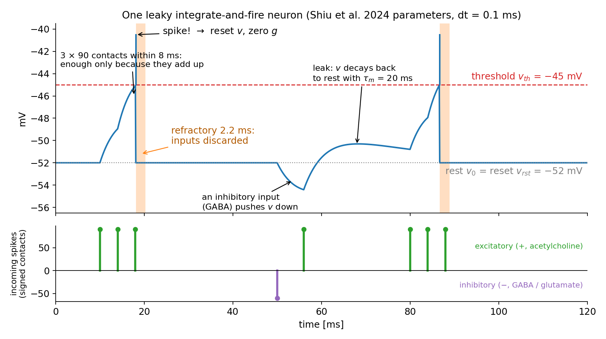
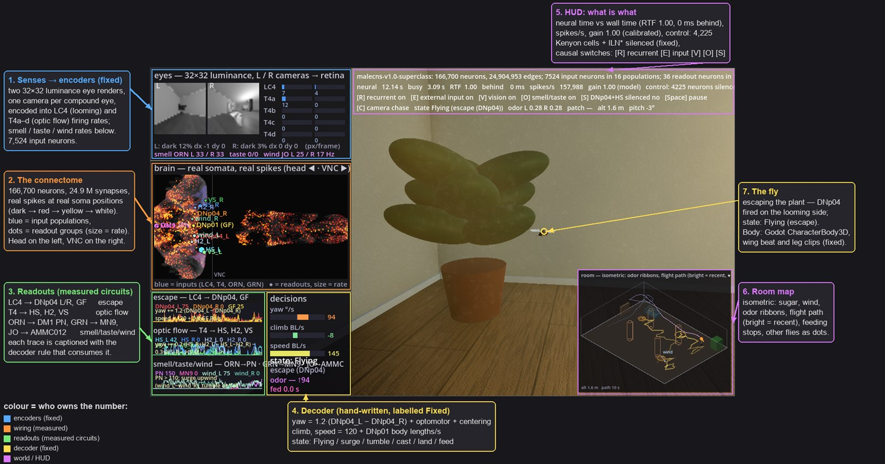

「果蝇大脑学会玩《毁灭战士》」这类消息每隔一阵就会出现一次。点进去看到的画面通常是一只虚拟果蝇在 3D 场景里移动，标题暗示某个真实的大脑正在里面拿主意。

真正跑在那个场景里的东西值得拆开看。它由三部分拼成：用电镜测出来的接线图、一套只有几个公式的神经元动力学、以及把世界翻译成神经元语言再翻译回来的两段工程代码。第三部分承担的工作，比大多数人以为的多得多。

Konrad Kokosa 在[原文](https://kokosa.dev/blog/2026/dotfly/)里把这三层逐条摊开，同时做了一件更硬的事：用纯 C# 写了一个推理引擎 dotFly，把完整的雄性果蝇中枢神经系统放进 Godot 的游戏循环，在笔记本上实时运行。这篇按「模型是什么 / 演示在做什么 / 工程怎么做的 / 边界在哪」重新组织，并补齐原文点到为止的几处计算和版本信息。

## 演示里跑的其实是三层东西

理解后面所有内容只需要三个词：

- **连接组（connectome）**：重建出来的接线图，记录哪个神经元连到哪个、中间有几个突触接触点、以及预测的神经递质类型。它是一张图，本身不做任何计算。
- **神经模型（neural model）**：让这张图动起来的方程。图不会自己放电，是方程在放电。
- **具身接口（embodiment）**：模型与身体、游戏、世界之间的那段工程代码。

互联网下载到的是第一项。加上动力学和接口之后才有画面。**没有人下载到一只冻结的活果蝇可执行文件。**

## 接线图是怎么来的，以及它不是什么

把整件事压缩成「Google 在九月绘制了果蝇大脑」会丢掉十几年工作：

- 2018，Zheng 等发表成年雌蝇大脑第一份完整电镜体数据（FAFB），约 100 TB 切片图像；
- 2024，FlyWire 联盟完成这份数据的全脑重建，约 14 万神经元、5,000 万突触（Dorkenwald 等）；
- 2024，Shiu 等在 Nature 发表这套全脑的第一个计算模型，并用真实实验验证——这是现在所有演示都在跑的那套动力学；
- 2025–2026，MaleCNS：一只五日龄成年雄蝇（标本 Z0720-07m），脑、颈、腹神经索一起解剖。

MaleCNS 的成像流程本身值得一提。标本用醛类固定、重金属染色、树脂包埋，热刀切成 66 块约 20 µm 厚的板，再用增强型聚焦离子束 SEM 以 8×8×8 nm 分辨率成像——镓离子束削掉薄薄一层，SEM 拍下新露出的面，重复。七台定制仪器，约 160 teravoxel 图像，成像耗时约 13 个月。之后是 Google 的 flood-filling 网络做神经元分割，自动检测器找突触，ResNet50 从电镜邻域判断神经递质，29 位专家校对员投入约 44 人年做修正和注释。

论文报告的规模是 166,700 个神经元、11,710 个细胞类型、约 2,560 万条有向边、1.24 亿个突触接触点。2026 年 9 月 3 日发表在 Cell，v1.0 数据 6 月就已放出，数据许可 CC BY 4.0。dotFly 从同一份发布数据建的 checkpoint 保留 2,490 万条边——差值是丢掉了递质不明确和组胺能的边，把它们当作空操作。

有一件事容易被跳过：**连接组是一张死脑切片、重金属染色之后的照片。** 它不是 fMRI，也不是活体电极记录。它不测膜电位或任何电活动，不测突触的功能强度（只数接触点），不测激素，也不包含这只果蝇死前学到、记住或感受到的任何东西。它是一张非常好的接线图，外加每个神经元一个预测出来的递质标签。

那模型怎么知道眼睛在哪里、腿在哪里？靠一个世纪的果蝇遗传学和神经解剖学。每个神经元都带注释——细胞类型（LC4、T4a、MN9、DNp04……）、类别、左右侧——由校对员根据形态、位置和连接性判定，并与文献对齐。所以文献里已知的事实可以直接拿来当输入输出的定义：LC4 对逼近的物体（looming）有反应，T4a–d 对应四个方向的运动，ORN_DM1 对应一种气味，糖感受神经元（GRN）对应糖，MN9 是伸出喙的 motor neuron，DNp04 和 Giant Fiber 是把指令送向腹神经索的逃逸下行神经元。

按这个约定，感觉神经元就是输入，下行神经元和 motor neuron 就是输出。约 1,300 个下行神经元把脑的指令传到神经索，motor neuron 驱动肌肉——这不是模型的假设，是解剖结构。

## 让它放电的那套方程

Shiu 等的做法是「用能跑起来的最简单的东西」：每个神经元是一个漏积分放电（leaky integrate-and-fire，LIF）点神经元。丢掉形状、树突和离子通道，只剩一个数——膜电位。输入的脉冲把它推高或压低，它按时间常数漏回静息值，越过阈值就发放一个脉冲并复位。

论文里的参数是：

| 参数                         | 值                            |
| ---------------------------- | ----------------------------- |
| 静息电位 V_rest              | −52 mV                        |
| 复位电位 V_reset             | −52 mV                        |
| 发放阈值 V_th                | −45 mV                        |
| 膜时间常数 T = R_mbr × C_mbr | 10 kΩ·cm² × 2 µF·cm⁻² = 20 ms |
| 突触电流衰减 τ               | 5 ms                          |
| 突触延迟                     | 1.8 ms                        |
| 不应期                       | 2.2 ms                        |

连接组进入方程的地方只有一处，就是每条边的权重：

```text
w_ij = sign(NT_i) · n_ij · W_syn
```

`n_ij` 是两个神经元之间的突触接触点数，显微镜数出来的。`W_syn` 对整个网络是同一个值：**0.275 mV 每接触点**。这是整个模型里唯一的自由参数——Shiu 等拿「刺激糖感受神经元，吐喙反射的强度要合理」把它标定出来，之后就固定不动，其余常数都来自此前的电生理文献。



上图解释了为什么发放需要汇聚。静息 −52 mV 到阈值 −45 mV 只差 7 mV，但突触电流以 5 ms 衰减，而膜时间常数是 20 ms，单个脉冲推上去的电位峰值会被时间常数大幅削减。一个有 90 个接触点的输入神经元单独放一次脉冲还不够；三个脉冲在 8 ms 内叠起来才越线。反过来说，要靠单个输入神经元的**一次**脉冲引发发放，大约需要 162 个接触点。原文给出的正是这两个数：3 × 90，以及 162。

`sign(NT_i)` 这一步对没有生物背景的读者需要单独说明。神经元通过在突触上释放化学物质和下一个神经元说话，每个神经元基本只用一种；有的物质兴奋下一个神经元，有的抑制它。连接组同样没测这个，是分类器从电镜图像里预测的。模型把整套化学压缩成一个 bit：乙酰胆碱是主要的兴奋性递质，记 +1；GABA 和谷氨酸抑制，记 −1；多巴胺、章鱼胺、5-羟色胺在真实神经系统里是调质——它们改变其他突触的行为、携带奖赏和唤醒一类的信息，而 LIF 没有地方表达这件事，Shiu 等干脆把它们算作兴奋性 +1。这是建模约定，不是生理学：给多巴胺神经元记 +1 并不等于实现了奖赏或学习。

模型的效果是：Shiu 等用它生成「激活这些神经元，那些应该放电」的预测，再拿光遗传学激活和钙成像在真实果蝇上验证。论文的原话是，在 164 条能够实测的预测中 91% 与实验结果一致；扣掉 split-GAL4 光遗传实验那一批（其中绝大多数细胞类型不会引起 MN9 激活）之后是 84%。这两个数字说的是这 164 条预测，不是整只果蝇的行为。

**还有一条是整个讨论的地基：权重是固定的，不训练。** 没有人为了让网络玩马里奥去拟合 2,490 万个权重，也不应该这么做——一旦开始用游戏分数拟合它们，它就不再是「果蝇的大脑」，只是一个恰好从果蝇形状的图出发的神经网络。原始模型里没有任何可塑性规则。

所以玩法始终是同一件事：**给输入，看输出。** 用 150 Hz 的泊松脉冲驱动糖感受神经元，看剩下十几万个神经元里谁开始放电；沉默一个神经元，看什么变了。这也正是它有价值的原因——一个可编程、可检验的神经回路模型，让假设变成一次运行。

## 那些「果蝇玩游戏」的演示分别在做什么

每一个这类演示都是同一套三段式，差别全在两头：

| 层                                  | 性质                       | 谁决定                |
| ----------------------------------- | -------------------------- | --------------------- |
| 输入神经元                          | 测量到的身份               | 连接组 + 细胞类型注释 |
| 连接组 + LIF 动力学                 | 测量到的连线，一个校准参数 | Shiu et al. 2024      |
| 读数神经元                          | 测量到的身份               | 连接组 + 细胞类型注释 |
| 编码器（世界 → 输入神经元的发放率） | 工程                       | 每个演示各写各的      |
| 解码器（读数 → 按钮或身体动作）     | 工程，固定或训练           | 每个演示各写各的      |

接线和动力学是共享的，适配器才是各家分道扬镳的地方，也是表面「智能」的主要来源。下面三个例子的细节来自原文作者的逐个核对，这里保留结论。

**Xenova 的浏览器演示**把完整的 166,700 神经元 MaleCNS LIF 放在 WebGPU 上跑，驱动一个 3D 果蝇身体，可以手动给神经元涂刺激。它的预设是「walk 刺激两侧 LC9」「turn left 刺激左侧 LC9 加左侧 DNa02」「fly 刺激两侧 LC4」。输出侧读一小批下行神经元——DNp09/DNg100/DNg97 对应前进速度，DNa02/DNa11/DNg13 的左右差对应转向，MDN（俗称 moonwalker，负责倒退的神经元）对应跳跃，DNp01（Giant Fiber）对应逃逸飞行——每个都配一个手选的增益。有一点需要知道：「转向」预设会直接刺激输出神经元 DNa02，而不只是视觉输入，作者说明了原因（只给视觉输入，DNa02 激活太弱），但这也意味着即使把脑内所有连接都剪断，果蝇仍然会转。

**Fly Dino** 走的是完全不同的路线：不用整个脑，只用 80 个神经元的子回路——32 个视觉探测神经元加 16 个下行神经元，挑选标准是它们在连接组里构成从「视觉事件」到「运动指令」连接最强的通路。它用 tanh 分级速率模型而不是脉冲 LIF，输入不是像素而是八个游戏特征。解码器是一张 243 个参数的小网络，通过 15,680 局游戏的试错训练出来，果蝇回路本身从头到尾没有变过。这就是 reservoir computing：把脑当作一个固定的、复杂的变换，只拟合最后那层「哪个动作」的映射。它漂亮的地方在于对照实验——把果蝇回路关掉、只留训练好的适配器，得分从 2,886 掉到 41。回路确实在做事。

**Fly64 / fly-games 这类「果蝇玩马里奥」** 用完整 MaleCNS LIF，但以 20 ms 的粗时间片推进，游戏帧被转成视觉探测器的特征（LC4 当作威胁、LPLC2 当作逼近物、LC10a 当作要追的目标），输出侧是十几个下行神经元组到按键的映射：DNa02 左右控制方向，DNp09 控制前进。Fly64 里这张表是手写的（左侧 DNa02 放电比右侧多就按左），fly-games 里用一小段线性回归从录制的人类操作里拟合。还是 reservoir computing。它在没见过的录制片段上能 90% 猜对按键，但实时玩的时候很快就死——因为实况会漂移到录制数据之外，马里奥一头撞在墙上不动了。

这些都不是批评，都是诚实的实验。要点是：**适配器的权重极大，而一个会动的身体什么都证明不了——除非你把对照也跑了，把脑内连接关掉、把输入关掉，看还剩什么。**

## dotFly：一个 .NET 推理引擎

dotFly 首先是一个库，不是一个演示：一个用 .NET 实现的果蝇连接组脉冲模型推理引擎，Godot、控制台程序、测试和基准测试都以进程内方式链接它。它把 MaleCNS 和 FlyWire 发布数据建成内存映射的 checkpoint，在上面跑 Shiu 等的模型——**精确**（float64 后端与 Brian2 逐脉冲一致）而且**快**（float32 SIMD 后端在笔记本上实时跑完整 MaleCNS）——并对外暴露「刺激进、脉冲和速率出」、录制与回放，以及那些因果开关。

它和作者上一个项目 dotLLM 在约定上一脉相承：内存映射的模型文件、非托管状态、SIMD 内核、热路径零分配。每个项目是一个 NuGet 包：

```text
src/DotFly.Core        .dfb checkpoint 读取（mmap）、图表、NeuronModel、RNG、IBackend
src/DotFly.Data        MaleCNS / FlyWire 发布数据读取
src/DotFly.Cpu         SIMD LIF 内核、计算线程池
src/DotFly.Engine      Simulation、输入/输出端口、实时驱动、录制器、适配器
src/DotFly.Adapters.*  ONNX Runtime / ML.NET 读数适配器
src/DotFly.Cli         dotfly build | inspect | run | bench | explore
```

有趣的是，把「刺激糖感受神经元、读吐喙 motor neuron」这个论文实验写成代码只需要十行左右：

```csharp
// 神经元用连接组发布数据里的精确 64 位 ID 寻址
using Brain brain = Brain.Open(".data/shiu2024/flywire-v630.dfb");
using Simulation sim = brain.CreateSimulation(new SimulationOptions { Seed = 1 });

NeuronSet sugar = brain.ByBodyIds("sugar_GRN_R", sugarGrnIds);   // Shiu 等的 21 个糖 GRN
sim.Input(sugar, InputKind.PoissonToV).Fill(150f);               // 每个 150 Hz 泊松驱动
OutputPort mn9 = sim.Output(brain.ByBodyId(Mn9), OutputKind.Rate(50.Ms()));

sim.Run(1.Seconds());                                            // 神经时间，不是墙钟
```

API 表面上就这几行，真正落地的是检查点格式、内核和线程模型。整套设计里起作用的是几条决定：checkpoint 用内存映射文件（`.dfb`，作者称之为 dotFly 的 GGUF），图用 CSR 存放——`rowPtr[N+1]`、`col[E]`、`w[E]`，其中权重是 int16 的带符号接触点数；状态用非托管的、64 字节对齐的 SoA 布局，整个 MaleCNS 约 2 MB，正好装进 L2；LIF 内核用 `Vector256<float>`，脉冲索引用 `TrailingZeroCount` 压缩。

## 房间演示：把「测量」和「工程」贴在屏幕上

房间演示是一只果蝇在阳光照进的客厅里，顺着气味云找到糖罐、落上去、伸出喙。它是用来看「一个非常薄的具身接口，配上一只自带感官的果蝇，还需要多少适配器」而搭的。

感知到输入这一段是固定的编码器：两只复眼各渲染一张 32×32 的亮度图，每只眼睛的暗区比例及其变化率变成 LC4（逼近）的发放率，水平与垂直图像位移变成 T4a–d（光流）的速率，两根触角上的气味浓度变成 ORN_DM1，风向变成 JO-C/E（Johnston 器官），落上去之后的糖接触驱动足部和口器的味觉神经元。一共 7,524 个输入神经元。

中间的连接组是测量出来的：166,700 个神经元按真实胞体位置绘制，被真实脉冲点亮。

读数侧只读那些用 CLI 在 checkpoint 里**确认存在**的回路（`dotfly inspect --upstream-of`、`dotfly run --stimulate`），13 组：

- LC4 → DNp04 左右 / Giant Fiber：逃逸
- T4a → HS、T4b → H2、T4c → VS：光流
- ORN_DM1 → DM1 投射神经元：气味量
- JO-C/E → AMMC012：风向
- GRN → MN9：进食

解码器是手写的，而且**规则直接印在屏幕上**，紧挨着它消费的那些读数：

| 脑信号               | 规则                                                                          | 行为             |
| -------------------- | ----------------------------------------------------------------------------- | ---------------- |
| DNp04 左右差         | yaw += 1.2 · (DNp04_L − DNp04_R)                                              | 从逼近侧转开     |
| HS + H2 左右差       | yaw += 0.2 · ((HS_R + H2_L) − (HS_L + H2_R))                                  | 反向补偿旋转     |
| HS 左右差            | yaw −= 0.3 · (HS_R − HS_L)                                                    | 在两墙之间居中   |
| DNp01（Giant Fiber） | speed = 120 + DNp01 体长/秒                                                   | 巡航，逃逸时爆发 |
| DM1_lPN（气味量）    | > 110 Hz 且上升 → 前进；下降 → 翻滚；丢失 → 掉头再搜索；> 270 Hz → 下降并着陆 | 气味搜索         |
| AMMC012 左右差（风） | 前进时 yaw −= 0.6 · (wind_L − wind_R)                                         | 逆风飞           |
| MN9（0.3 s 平滑）    | > 15 Hz → 进食；停止 → 起飞                                                   | 进食             |



一个有意思的发现写在表格下面：**气味的方向根本读不出来。** 两个 DM1 候选投射神经元对刺激哪一根触角反应一样，所以搜索行为只能靠适配器里的逻辑来补——气味变浓就继续前进，变淡就掉头，风信号来自脑本身。

## 塞进游戏循环要付的性能账

整个 MaleCNS 在作者的 8 核笔记本（Ryzen 7 5800HS，AVX2）上的实测：

| 场景                                                 | 神经元  | 实时倍率 | 步/秒   |
| ---------------------------------------------------- | ------- | -------- | ------- |
| FlyWire v630，21 个糖 GRN @ 150 Hz（Shiu 实验）      | 127,400 | 19.6×    | 196,000 |
| MaleCNS v1.0，无输入                                 | 166,700 | 14.5×    | 145,000 |
| MaleCNS v1.0，1,684 个 T4a @ 150 Hz（0.5 M 脉冲/秒） | 166,700 | 6.2×     | 62,000  |

作者还顺手把同一份工作放到别的实现上跑了一遍。用同一个 MaleCNS 图、同样的刺激，脉冲计数在各实现之间只差随机数种子（T4a 场景都是 534–539 k），所以他比的是同样的计算量：

| 实现                                                 | 场景                        | 步/秒   | 实时倍率 |
| ---------------------------------------------------- | --------------------------- | ------- | -------- |
| Shiu 等的论文，Brian2（论文报告值，每 CPU 线程）     | v630，糖 GRN @ 150 Hz       | ~33     | 0.003×   |
| Brian2 2.9，numpy 后端，Python（同机）               | v630，糖 GRN @ 150 Hz       | ~400    | 0.04×    |
| Xenova BrainCPU，JavaScript 于 Chrome worker，1 线程 | MaleCNS，1,684 T4a @ 150 Hz | 628     | 0.06×    |
| Xenova BrainCPU，JavaScript 于 Node 24，1 线程       | MaleCNS，1,684 T4a @ 150 Hz | 851     | 0.09×    |
| Xenova BrainGPU，WebGPU 于集显 Radeon（Vega 8）      | MaleCNS，1,684 T4a @ 150 Hz | 2,409   | 0.24×    |
| Xenova BrainGPU，WebGPU 于 RTX 3050 Ti Laptop        | MaleCNS，1,684 T4a @ 150 Hz | 5,383   | 0.54×    |
| dotFly，C#，1 线程                                   | MaleCNS，1,684 T4a @ 150 Hz | 10,740  | 1.07×    |
| dotFly，C#，8 线程                                   | MaleCNS，1,684 T4a @ 150 Hz | 43,656  | 4.37×    |
| dotFly，C#，8 线程                                   | v630，糖 GRN @ 150 Hz       | 196,000 | 19.6×    |

同线程数下，C# 比 JavaScript 参考实现快约 11 倍。原因不是 JavaScript 慢（V8 处理类型化数组很好），而是 JIT 不会免费给你的东西：`Vector256` 一次处理八个神经元、状态布局刚好装进 L2、散布写（scatter）没有边界检查、投递循环只访问自己那份常驻缓存里的 `g` 切片。

这里面有一个纯粹 .NET 侧的坑值得单独记：**每个逐步骤方法都要加 `[MethodImpl(MethodImplOptions.AggressiveOptimization)]`，这是最大的一处意外。** 不加的话，分层 JIT 会把内核和批处理循环在一次短运行的大部分时间里留在 tier-0/OSR，每步 21 µs 而不是 6 µs。同类坑还有 Godot：Debug 构建会把被引用的项目一起拖进 Debug，必须用 `SetConfiguration="Configuration=Release"` 钉住库引用，否则内核慢 25 倍。

上表不包含以 20 ms 步长推进的那些演示。步数少 200 倍，它们便宜是构造使然，代价是那已经不是 Shiu 模型了。

## 还挡在前面的两个限制

**第一，视觉的边界放错了位置。** 今天 C# 这边直接计算「视叶应该算出什么」：视网膜编码器把图像位移和扩张直接变成 T4 和 LC4 的信号，跳过了逼近通路的前四个环节。真实果蝇的复眼由约 800 个小眼组成，后面跟着一整块视叶——占了全脑神经元相当大的比例——它存在的意义正是从感光细胞的信号里算出运动和逼近。下一个里程碑是把光直接喂进感光细胞，看中间的连线能不能自己算出运动和逼近：如果能，编码器就缩成「每只眼睛的亮度」；如果不行，退路是接一个 Flyvis 式训练出来的视叶。

**第二，果蝇自己的导航回路是静默的，这是更大的那个。** 演示里「往哪走」——逆风前进、翻滚、搜索、着陆——是作者的解码器决定的。真实果蝇在自己的脑里做这件事，而且那个回路就写在连线里：记录朝向、与风和气味结合、驱动转向神经元 DNa02 左右两侧的那些神经元。把风和气味输入打开，它们一个都不放电：DNa02 只有 0–8 Hz，DNa03 ≤ 10 Hz，EPG 3–13 Hz 且左右对称，PFL3 / hΔC ≈ 0。原因是这个回路是递归的——它自己反馈给自己，活动只能靠活跃神经元一边兴奋邻居一边抑制其余部分来维持。当前的 Shiu 模型表达不了这类动力学。

还有一处作者主动标在 HUD 上的权宜之计：增益为 1.0 时会有失控的吸引子。一侧 LC4 输入几个赫兹就会点燃视叶回路（约 450 k 脉冲/秒，而且停不下来），任何 ORN 输入都会点燃触角叶—蘑菇体回路。演示的办法是把 4,225 个 Kenyon 细胞和 `lLN*` 局部神经元静默掉，之后所有用到的读数都是分级响应、输入停止一秒内回落。均匀的 LIF 缺少这些群体在活体里的稀疏化机制（APL 抑制、Kenyon 细胞的高阈值、局部神经元的增益控制）。这件事被印在屏幕上，而不是藏起来。

## 自己动手

dotFly 是 **GPL-3.0**，连接组数据是 **CC BY 4.0** 且需要单独下载。跑起来需要 **.NET 11 SDK（RC1 或更高）**，只有两个 Godot 演示需要 **Godot 4.7 .NET 版**；磁盘上 FlyWire v630 约 300 MB，MaleCNS v1.0 加 checkpoint 约 3 GB。库、CLI 和糖实验可以只用 FlyWire 数据，房间演示才需要 MaleCNS。

最短路径是先跑论文里那个糖实验：

```bash
git clone https://github.com/kkokosa/dotFly
cd dotFly
dotnet build -c Release
dotnet test  -c Release        # 94 个单元与集成测试，不需要数据

# 取 FlyWire v630（约 90 MB），建 checkpoint
git clone --depth 1 https://github.com/philshiu/Drosophila_brain_model .data/shiu2024
dotnet run --project src/DotFly.Cli -c Release -- build flywire \
  .data/shiu2024/2023_03_23_completeness_630_final.csv \
  .data/shiu2024/2023_03_23_connectivity_630_final.parquet -m 630

# 30 次糖 → MN9 试验，约 2 秒
dotnet run --project samples/DotFly.Sample.SugarExperiment -c Release
```

验收方式很直接：它会打印活跃神经元数、MN9 的平均发放率，并与论文发布的 `sugarR.parquet` 对照——活跃神经元 448 vs 433（Jaccard 0.949）、逐神经元速率相关 0.9946、MN9 93.3 Hz vs 83.3 Hz。作者自己的结论是 Brian2 2.5.1 和 2.9 复现的是 dotFly 的结果而不是那份发布速率文件，剩下的差异属于发布文件。

想验证「给输入看输出」这条主线，可以用 CLI 做几个最小实验：

```bash
# 刺激左侧 71 个 LC4 神经元，看谁放电（逃逸通路会不会自己亮起来）
dotfly run <ckpt> --stimulate "type:LC4@L" --hz 120 --seconds 1

# 谁在驱动吐喙 motor neuron
dotfly inspect <ckpt> --upstream-of <MN9 id> --hops 2 --min-weight 5

# 刺激停止后读数会不会回到基线（失控吸引子）
dotfly run <ckpt> --stimulate "type:ORN_DM1" --hz 60 --seconds 3 --stim-seconds 1 \
  --silence "class:Kenyon_Cell;type:lLN*"
```

一个判断值得留在最后。这套东西的价值不在「我们能模拟大脑了」，而在两件分开的事：平台层面，.NET 可以在笔记本上实时跑完 166,700 个神经元、约 2,490 万个突触的脉冲网络，线程数变化不影响结果，且与科学参考实现一致——`Vector256`、`NativeMemory`、内存映射文件和手写线程池就够了；科学层面，连接组是一次壮观的测量，LIF 模型是一个壮观的起点，而今天所有让果蝇「玩游戏」的东西都是适配器，它们应该被显示在屏幕上，并且在一组对照实验里被关掉。

原文作者的邀请是：如果你是想从 C# 里戳一戳真实大脑的 .NET 开发者，或者是想要一个比参考实现快三个数量级的内循环的神经科学家，去刺激点什么，沉默点什么，然后告诉他什么在放电。

## 参考

如果这类「把科学模型和工程实现摆在一起看」的拆解对你有用，Aide Hub 会继续分享 .NET 工程实践、AI 助手和开发工具的整理，欢迎关注。

- [dotFly - a fruit fly's brain, simulated in C#（原文）](https://kokosa.dev/blog/2026/dotfly/)
- [dotFly 源码（GPL-3.0）](https://github.com/kkokosa/dotFly)
- [dotFly 文档](https://kkokosa.github.io/dotFly/)
- [dotFly：Measured vs engineered 清单](https://kkokosa.github.io/dotFly/honesty.html)
- [Shiu et al. 2024, A Drosophila computational brain model reveals sensorimotor processing（Nature 634: 210–219）](https://doi.org/10.1038/s41586-024-07763-9)
- [Berg et al. 2026, Sexual dimorphism in the complete Drosophila male central nervous system connectome（Cell 189: 5504–5526）](https://doi.org/10.1016/j.cell.2026.08.015)
- [MaleCNS 项目页与数据下载（CC BY 4.0）](https://male-cns.janelia.org/)
- [FlyWire](https://flywire.ai/)
- [Xenova 的浏览器端果蝇仿真](https://huggingface.co/spaces/Xenova/fruit-fly-simulation)
- [Fly Dino](https://flydino.cobanov.dev/)
