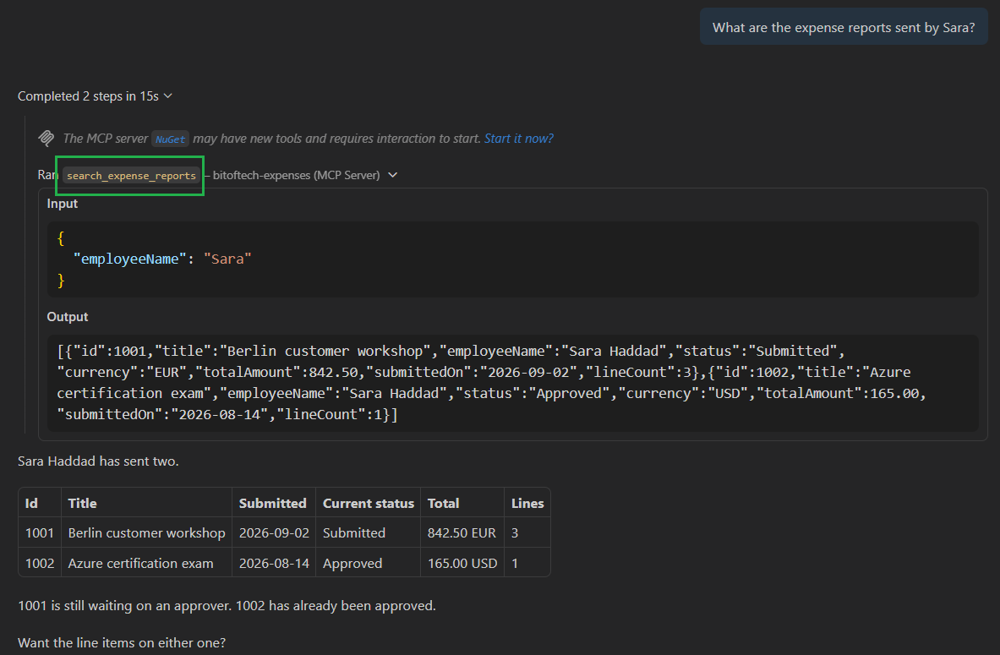
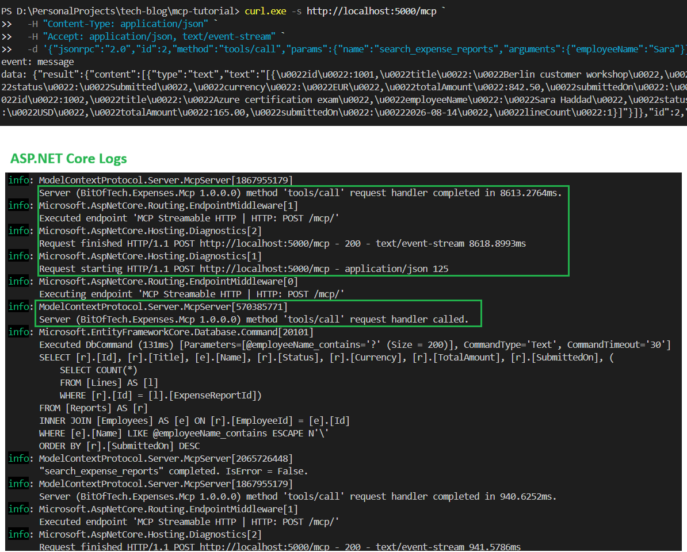

一个用 stdio 运行的 MCP 服务器，功能都调通了，然后你想给它加认证。这时会发现没有地方可以加：stdio 没有请求，没有请求就没有地方放令牌，每次调用在协议层面都是匿名的。想部署到容器平台同样行不通——服务器只在编辑器开着的时候存在。

Taiseer Joudeh 在这个系列[第五篇](https://bitoftech.net/2026/10/08/hosting-mcp-server-aspnet-core-streamable-http/)里把它改成 Web 应用，用来承接后面的 Entra ID 认证、容器部署和 Foundry 接入。值得注意的是改动量：工具、资源、提示词一行都没动，真正的传输层改动是两个方法调用。

## stdio 的四堵墙

stdio 的工作方式是宿主把服务器当子进程拉起来，请求走标准输入，响应走标准输出。没有网络、没有端口、没有地址。由此产生四个限制：

- **一个进程一个客户端**。宿主拥有它启动的那个进程，第二个客户端意味着第二个进程和另一套内存、连接池、缓存。
- **只能同机**。标准输入输出不跨网络，客户端必须能启动这个可执行文件。
- **生命周期不由你控制**。关掉 VS Code，服务器就没了，没人看着它的时候任何东西都调不到它。
- **没有身份**。没有请求就没有承载令牌的位置，服务器无从区分调用者。

还有第五点容易忽略：stdio 模式下 **stdout 就是协议本身**。所以原来的服务器里一直有这么一行：

```csharp
builder.Logging.AddConsole(options => options.LogToStandardErrorThreshold = LogLevel.Trace);
```

所有日志必须走 stderr，因为写进 stdout 的任何内容都会被当成协议消息解析，直接打断连接。依赖库里一句多出来的 `Console.WriteLine` 就足以让服务器挂掉。改成 HTTP 之后这个约束彻底消失。

## 这不是又一个 REST API

已经写过 ASP.NET Core API 的人会问：有 HTTP、有 JSON、有 Minimal API，为什么还需要一套传输规范？

因为两者面向的客户端不同。REST API 面向「照文档写出来」的客户端——调用 `GET /reports?employee=x` 的代码是先知道这个地址存在才写出来的，调用知识存在客户端里。MCP 服务器面向「从没见过它」的客户端——模型在运行时发现有什么可用，读我们写的描述，再决定调什么，调用知识存在服务器里。

这个差别带来三个 REST 没有的要求：

1. **发现是协议的一部分**。`tools/list` 不是我们写的端点，而是每个 MCP 服务器都要以同样方式回答的方法，这才让客户端能连接一个没人告诉过它的服务器。
2. **一个端点承载多个方法**。MCP 基于 JSON-RPC，工具、资源、提示词都发到同一个 URL，靠请求体里的 `method` 字段区分，而不是靠路由。
3. **一次响应可能是多条消息**。一个跑三十秒的工具可以在执行过程中报告进度，HTTP「一次请求一次响应」的形状覆盖不了。

第三条正是 Streamable HTTP 形状的来源。

## Streamable HTTP 长什么样

客户端到服务器是一次 POST：所有消息都是发往同一个 URL 的 POST，带 JSON-RPC 请求体，列表、调用、读资源、取提示词全都如此。

服务器到客户端的响应则出人意料：**响应不是 `application/json`，而是 `text/event-stream`**，也就是浏览器 `EventSource` 用的那套 SSE 格式。哪怕只有一条回复也照样带帧：

```text
HTTP/1.1 200 OK
Content-Type: text/event-stream

event: message
data: {"result":{"tools":[ ... ]},"id":1,"jsonrpc":"2.0"}
```

带帧的原因是第三条要求：一次 POST 可能先产生进度通知、再产生结果，SSE 让服务器能在一条未关闭的响应里连续写多条消息。只有一条消息时也保持同样的形状，是为了不让客户端处理两种响应格式。

会话（如果存在）放在 `Mcp-Session-Id` 请求头里，服务器在第一次响应里返回，客户端后续每次请求都带上，相当于 MCP 的 Cookie。

需要注意的是，MCP 里还有一个更早的 HTTP 传输，用两个独立端点分别处理 POST 和 SSE。C# SDK 已经把它标记为过时，并在警告里明确指出它没有请求背压，只应在完全信任的客户端场景下使用。新项目不要从这里开始。

## 握手正在消失

传统的 MCP 对话都从 `initialize` 开始：客户端声明自己说的协议版本，服务器回自己的版本和 capabilities，之后才能列工具。

但向一台冷启动的服务器直接请求 `tools/list`，不先 `initialize`，现在也能拿到全部工具列表。原因是协议本身变了，而不是 SDK 删了实现：**2026-07-28 这一版移除了 `initialize` 握手**。配套的两项改动是：

- `initialize` 被 `server/discover` 取代，服务器通过它公布自己支持的协议版本、能力和身份。
- 每个请求自带协议版本与客户端能力，通过 HTTP 上的 `MCP-Protocol-Version` 请求头，以及各传输上的 `_meta` 字段（`io.modelcontextprotocol/protocolVersion`、`.../clientCapabilities`）传递。版本不匹配返回 `UnsupportedProtocolVersionError`（`-32022`）。
- `Mcp-Session-Id` 请求头被移除，协议层不再有会话。列表类方法（`tools/list`、`resources/list`、`prompts/list`）的返回结果不再随连接变化。

C# SDK 的客户端不需要在这两个世界之间做选择：它优先使用 2026-07-28，先用 `server/discover` 探测服务器，探测失败就回退到 `initialize` 握手。也就是说新协议对上新服务器、旧协议对上旧服务器，两边都不用你写代码。

如果你读过过去一年里的 MCP 材料，这是变化最大的一处。几乎所有讲解都从握手开始，而最新版协议里已经没有它了。

## 默认无状态，以及它的代价

C# SDK 有三种会话模式，**无状态是默认值**，另外两种只为兼容旧客户端保留：

```text
'HttpServerTransportOptions.IdleTimeout' is obsolete: 'Stateful Streamable HTTP mode is a
back-compat-only escape hatch for 2025-11-25 protocol revision clients and earlier. Set
HttpServerTransportOptions.SessionMode = HttpServerSessionMode.Stateless (the default as
of the 2026-07-28 protocol revision) for new code.'
```

有状态模式里，服务器为每个客户端保留一个会话对象，里面存协商好的协议版本、客户端能力、资源订阅，以及用于推送消息的那条 SSE 流。它待在某个进程的内存里，于是多副本部署时同一客户端的每个请求都必须落到持有该会话的那个副本上——这就是会话粘滞，也是无状态带来的最大收益所在。无状态模式下每次 POST 自带回答所需的一切，服务器答完就忘，不返回会话 ID，横向扩展不需要任何额外配置。

代价也很具体：对端点发 GET 请求会得到

```text
405 Method Not Allowed
```

没有会话就没有流，没有流服务器就无法主动开启对话。需要服务器主动推送时，才需要考虑有状态模式，并且要在负载均衡器上安排粘滞。

这里有一个容易忽略的联动：**有状态模式的服务器会拒绝 2026-07-28 这一版协议**，因为那一版没有会话可以发放。保持无状态，才是让最新协议版本对你的客户端可用的前提。

另外，2026-07-28 里服务器主动推送的机制也变了：原来的 HTTP GET 端点和 `resources/subscribe` / `resources/unsubscribe` 被 `subscriptions/listen` 取代——客户端发起一个长期存在的 POST，通过响应流接收自己订阅的变更通知（`toolsListChanged`、`promptsListChanged`、`resourcesListChanged`、`resourceSubscriptions`）。SSE 的断点续传和消息重投也被移除，响应流中断就丢了这次请求，客户端必须以新的请求 ID 重新发起。

## 它就是一个普通的 ASP.NET Core 端点

这一点官方文档说得不清楚，但对整个系列影响很大：`app.MapMcp("/mcp")` 注册的是普通的 ASP.NET Core 端点，它会像其他端点一样出现在路由表里，服务器日志里能看到：

```text
info: Microsoft.AspNetCore.Routing.EndpointMiddleware[0]
      Executing endpoint 'MCP Streamable HTTP | HTTP: POST /mcp/'
```

也就是说，你已经熟悉的一切都适用：认证、授权、CORS、限流、响应压缩等中间件照常运行；`Microsoft.AspNetCore.Hosting.Diagnostics` 会像记录其他请求一样记录 MCP 请求；工具类走正常的依赖注入，按请求解析；还可以在旁边 `MapGet` 别的端点。

这也是后面「给 MCP 服务器加 Entra ID」那一篇会比预想的短的原因：给 MCP 服务器加认证，主要就是给一个 ASP.NET Core 端点加认证。

## 迁移的六步

改动落在四个文件上，另有一个新文件，其中没有一个是工具、资源或提示词。

**第一步，加 HTTP 传输包。** MCP 的包是刻意拆开的：`ModelContextProtocol` 是核心加托管，完全不知道 ASP.NET Core 的存在，这也是控制台服务器能保持很小的原因。HTTP 传输在单独的包里：

```bash
dotnet add package ModelContextProtocol.AspNetCore --version 2.2.0
```

它和 `ModelContextProtocol` 版本严格绑定，升级时两个包要一起动。`2.2.0` 是目前 NuGet 上的最新版本。

**第二步，把项目切成 Web SDK。** 这一行是控制台应用变成 Web 应用的关键，它带来的不只是 SDK 名字变化——ASP.NET Core 共享框架会一并引入，几个原来手动引用的包已经在框架里了。改完之后四个引用被删掉，各有用意：

- `<OutputType>Exe</OutputType>`：Web SDK 已经隐含，属于噪音。
- `Microsoft.Extensions.Hosting`：已在 ASP.NET Core 共享框架中。
- `Microsoft.Extensions.Http`：同样在框架中，外部 API 客户端少一个包引用也能继续工作。
- `appsettings.json` 的 content 项：**这一条漏了会直接构建失败**。Web SDK 已经把 `**/*.json` 当作内容包含进来，保留原来那一行会报重复项错误。

**第三步，重写 `Program.cs`。** 真正的改动只有两处：`WithHttpTransport()` 注册传输，`app.MapMcp("/mcp")` 挂载端点。

```csharp
var builder = WebApplication.CreateBuilder(new WebApplicationOptions
{
    Args = args,
    // The working directory belongs to whoever started us, so appsettings.json has to be
    // read from the folder the binary is in rather than the current directory.
    ContentRootPath = AppContext.BaseDirectory
});

builder.Services.AddDbContext<ExpensesDbContext>(options =>
    options.UseSqlServer(builder.Configuration.GetConnectionString("ExpensesDb")));

builder.Services.AddHttpClient<FrankfurterClient>(client =>
{
    client.BaseAddress = new Uri("https://api.frankfurter.dev/");
    client.Timeout = TimeSpan.FromSeconds(10);
});

builder.Services
    .AddMcpServer()
    .WithHttpTransport()
    .WithToolsFromAssembly()
    .WithResourcesFromAssembly()
    .WithPromptsFromAssembly();

var app = builder.Build();

app.MapMcp("/mcp");

app.Run();
```

逐项对照：`Host.CreateApplicationBuilder` 换成 `WebApplication.CreateBuilder`（配置系统和依赖注入不变，底下多了 Kestrel）；`WithStdioServerTransport()` 换成 `WithHttpTransport()`，这就是传输层的全部改动；三个 `...FromAssembly()` 原封不动，工具完全不知道发生了什么。

还有一处删除：之前那行强制日志走 stderr 的代码可以删掉了，stdout 不再是协议。

无状态模式还让「每次工具调用有独立的依赖注入作用域」这件事变得更简单：每次工具调用本身就是一次 HTTP 请求，ASP.NET Core 每请求创建一个作用域，作用域内的 `DbContext` 依然安全。

**第四步，固定端口。** 服务器需要一个可预测的地址，因为下一步要把它写进配置文件。新建 `Properties/launchSettings.json`，把 `applicationUrl` 设为 `http://localhost:5000`。两点说明：这个文件只用于开发，不参与发布、也不进容器；绑定 `localhost` 是刻意的，绑到 `0.0.0.0` 意味着这个还没有任何认证的费用服务器对同网络的任何机器开放。

**第五步，把 VS Code 指向端点。** `.vscode/mcp.json` 变短了，但含义变大了——VS Code 不再启动任何东西，而是连接到你自己运行的进程：

```json
{
  "servers": {
    "bitoftech-expenses": {
      "type": "http",
      "url": "http://localhost:5000/mcp"
    }
  }
}
```

开发循环随之变化：先在一个终端里自己启动服务器（`dotnet run --project src/BitOfTech.Expenses.Mcp`），再从 `MCP: List Servers` 重新加载。多了一件要记的事，换来两件好处：每个到达 `/mcp` 的请求都会实时打印在你的终端里，排查 stdio 时那种从 VS Code 输出通道里捞异常的日子结束了；之前「服务器被宿主悄悄启动、占住可执行文件导致构建失败」的文件锁问题也消失了。

**第六步，直接用 curl 看协议。** 现在服务器是普通 HTTP 端点，可以手动对话。这一步值得至少做一次，因为后面所有工作都建立在它之上：

```powershell
curl.exe -i http://localhost:5000/mcp `
  -H "Content-Type: application/json" `
  -H "Accept: application/json, text/event-stream" `
  -d '{"jsonrpc":"2.0","id":1,"method":"tools/list"}'
```

响应（已裁剪）：

```text
HTTP/1.1 200 OK
Content-Type: text/event-stream

event: message
data: {"result":{"tools":[{"name":"search_expense_reports", ... }]},"id":1,"jsonrpc":"2.0"}
```

三个可验证的结论：没有 `initialize`，冷启动的服务器照样回答了工具列表；响应头里没有 `Mcp-Session-Id`，因为没有任何东西需要标识；内容类型是 `text/event-stream`，不管用不用得上都带帧。

注意上面用的是 PowerShell 7，JSON 放在单引号里不需要转义；在 Windows PowerShell 5.1 上参数传递规则不同，内层双引号需要转义。用 `curl.exe` 而不是 `curl`，是为了避免被 PowerShell 自己的别名接管。

如果把 `text/event-stream` 从 `Accept` 头里去掉再请求一次，会得到：

```json
{
  "error": {
    "code": -32000,
    "message": "Not Acceptable: Client must accept both application/json and text/event-stream"
  }
}
```

这是一个 406，也是手写第一个客户端时最容易撞上的错误：传输层要求你声明能处理两种响应形状才肯对话。错误信息本身写得不错，前提是你知道它在说什么。

## 怎么确认没有改坏

这是整个系列里结构改动最大的一次，值得用实际调用而不是「应该没问题」来确认。把上面的 `tools/list` 换成 `tools/call`：

```powershell
curl.exe -s http://localhost:5000/mcp `
  -H "Content-Type: application/json" `
  -H "Accept: application/json, text/event-stream" `
  -d '{"jsonrpc":"2.0","id":2,"method":"tools/call","params":{"name":"search_expense_reports","arguments":{"employeeName":"Sara"}}}'
```

Sara 的两条报销单会从 Azure SQL 经 HTTP 返回。把 `method` 换成 `resources/list`、`resources/read`、`prompts/list`、`prompts/get` 也都能正常应答。



再按正常方式用一次：向 Copilot 提和之前一样的问题，一边看它回答，一边看终端里请求陆续到达。图中可以看到工具调用参数、返回的 JSON，以及模型整理出的表格；终端侧则是请求日志和实际执行的 SQL：



没有变的东西也值得列出来，因为这是「MCP 是协议而不是库」的最好论据：工具没变（一个参数、一句描述、一行校验都没动），资源和提示词没变，数据库代码没变，为了让响应体更小而设计的契约也没变。让这台服务器有用的所有东西都是针对 MCP 写的，不是针对 stdio 写的。

## 两件必须说清的事

第一，**这个端点没有任何认证**。能访问 5000 端口的人都能列出并调用你的工具，包括那个写入数据库且无法撤销的 `submit_expense_report`。在 localhost 上风险是收敛的，放到其他任何地方都不是。这也是作者坚持先做认证、再做部署的原因：先发布一个能花钱的开放端点、再承诺后续补上安全，是写不得的。

第二，**你自己的机器不是私有空间**。本机上的任何东西都能调用这个端点，包括不是你写的代码。这正是 MCP 规范要求校验收到的 `Host` 请求头的原因，作者把这件事留到了该系列的第十篇。

Aide Hub 会继续分享 AI 助手、开发工具和软件工程实践方面的内容，包括 MCP 服务器从本地调试到上云部署的完整路径。

## 参考

- [Part 5: Hosting an MCP Server in ASP.NET Core with Streamable HTTP — Taiseer Joudeh](https://bitoftech.net/2026/10/08/hosting-mcp-server-aspnet-core-streamable-http/)
- [MCP 规范 2026-07-28 变更说明](https://modelcontextprotocol.io/specification/2026-07-28/changelog)
- [Model Context Protocol 规范](https://modelcontextprotocol.io/specification)
- [MCP C# SDK（modelcontextprotocol/csharp-sdk）](https://github.com/modelcontextprotocol/csharp-sdk)
- [ModelContextProtocol.AspNetCore — NuGet](https://www.nuget.org/packages/ModelContextProtocol.AspNetCore)
- [示例源码（tjoudeh/building-mcp-servers-dotnet）](https://github.com/tjoudeh/building-mcp-servers-dotnet)
- [ASP.NET Core 中的 Minimal API](https://learn.microsoft.com/aspnet/core/fundamentals/minimal-apis/overview)
- [ASP.NET Core 中的环境](https://learn.microsoft.com/aspnet/core/fundamentals/environments)
