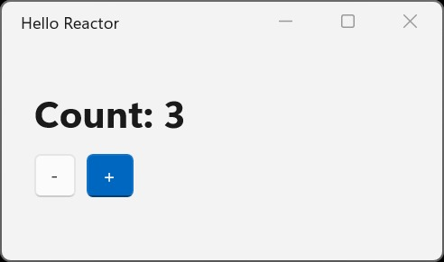

同一个 WinUI 计数器，XAML 版至少要五个文件和一个 `.csproj`：窗口标记、code-behind、ViewModel、`App.xaml`，再加上 `App.xaml.cs` 完成引导。微软 10 月 21 日放出的实验性框架 Microsoft.UI.Reactor 把它写成一个 `counter.cs`，包引用和构建属性都在这个文件里，`winapp run counter.cs` 就能弹出真实的 WinUI 窗口。

核心结论先放在这里：**Reactor 把「状态到界面」这条链路从 XAML 绑定换成一个纯 C# 函数，底层控件没换。它值得现在花半小时验证，但还不值得押进交付计划——项目自己标着实验性，没有支持策略，也没有 API 保证。**

原文标注这是系列第一部分（part 1 of 3），作者 Alexandre Zollinger Chohfi 在微软做开发者工具。

## 一个文件就是一个应用

原文给的完整应用如下，不是节选，包括包引用和构建属性：

```csharp
#:package Microsoft.UI.Reactor@0.1.0-preview.16
#:property OutputType=WinExe
#:property TargetFramework=net10.0-windows10.0.22621.0
#:property UseWinUI=true

using Microsoft.UI.Reactor;
using Microsoft.UI.Reactor.Core;
using static Microsoft.UI.Reactor.Factories;

ReactorApp.Run<MyApp>("Hello Reactor", width: 340, height: 200);

class MyApp : Component
{
    public override Element Render()
    {
        var (count, setCount) = UseState(0);

        return VStack(
            TitleBar("Hello Reactor"),
            VStack(12,
                Heading($"Count: {count}"),
                HStack(8,
                    Button("-", () => setCount(count - 1)),
                    Button("+", () => setCount(count + 1))
                        .AccentButton()
                )
            ).Padding(24)
        ).Backdrop(BackdropKind.Mica);
    }
}
```

存成 `counter.cs`，运行：

```bash
winapp run counter.cs
```

顶部那几行 `#:` 是 .NET 10 的 file-based app 能力：包引用和构建属性写在代码文件里，适合快速验证想法。`winapp run` 会编译这个文件，按 `#:property` 生成包清单，然后带着真实的包身份启动，而不是跑一个松散的 `.exe`。窗口打开后是真的 `TitleBar`、`TextBlock` 和两个 `Button`，`Count` 从 0 开始，加减都正常。



关键在于 `Render()` 的返回类型：`Element` 是一份不可变的界面描述，不是控件本身。点击按钮时 `setCount` 更新状态，Reactor 重新执行 `Render()`，把新描述和上一份做 diff，只把真正变化的属性打到下面真实的 WinUI 控件上。`UseState` 返回当前值和 setter，`VStack`、`HStack`、`Button` 这些工厂函数组合出描述树。

这就是 MVU（Model-View-Update）的全部骨架：状态放在一处，更新函数返回下一个状态，视图是状态的纯函数。

## MVU 和 MVVM 不是新旧关系

XAML 应用通常走 MVVM：状态放在 ViewModel 上，ViewModel 通知变化，绑定把新值拉进控件。Reactor 走 MVU：状态只有一份，视图从状态直接算出来。Elm 让这个模式流行起来，React、SwiftUI、Jetpack Compose 都是它的变体。

原文特意强调两者是「两种有不同取舍的成熟模式」，WinUI 现在两种都能跑。这句话不是客套：Reactor 不是新 UI 平台，没有新渲染器，也没有 fork 任何东西。你写的 `Button`、`TextBox`、`NavigationView`、`TreeView` 拿到的是真控件，由同一套面板布局、同一套主题资源渲染，也能被同一批工具检查。少数部件是自己实现的，比如 flex 布局面板，但同样建立在 XAML 应用使用的那批原语之上。

微软做这件事的动机也值得看清楚，它决定了你该怎么评估这个项目：

- 想知道 MVU 在 WinUI 上能走多远；
- 对已经用 React、React Native、SwiftUI、Compose 建过界面的人，省掉「先学一门标记语言和一套绑定引擎」这一步；
- 界面写成普通 C# 之后，coding agent 更容易读写和检查，所以项目现在同时按「给 agent 用」来设计；
- 给 WinUI 一个试验田：先在这里试新控件和新模式，验证过的再考虑回流到 WinUI 本身，让 XAML 应用也能用上。

## 同一个计数器，两套写法

为了公平，原文的 XAML 版本是按 2026 年的好写法给的：用 `x:Bind`，让 MVVM Toolkit 的源生成器承担样板代码，而不是照着十年前的教学文章挑刺。

```xml
<!-- MainWindow.xaml（节选） -->
<StackPanel Spacing="12" Padding="24">
    <TextBlock Text="{x:Bind ViewModel.CountText, Mode=OneWay}"
               Style="{StaticResource TitleTextBlockStyle}" />
    <StackPanel Orientation="Horizontal" Spacing="8">
        <Button Content="-" Command="{x:Bind ViewModel.DecrementCommand}" />
        <Button Content="+" Command="{x:Bind ViewModel.IncrementCommand}"
                Style="{StaticResource AccentButtonStyle}" />
    </StackPanel>
</StackPanel>
```

```csharp
// CounterViewModel.cs
public partial class CounterViewModel : ObservableObject
{
    [ObservableProperty]
    [NotifyPropertyChangedFor(nameof(CountText))]
    public partial int Count { get; set; }

    public string CountText => $"Count: {Count}";

    [RelayCommand] private void Increment() => Count++;
    [RelayCommand] private void Decrement() => Count--;
}
```

源生成器确实消掉了大部分样板，但原文指出三件仍然成立的事，我认为这部分是全文最有说服力的论证：

1. **值要跨三个文件和两种语言才到达像素。** `{x:Bind ViewModel.CountText}` 本质是一个字符串，XAML 编译器得额外学会理解它；从 C# 端给 `CountText` 改名，你得指望工具链跟得上。
2. **状态住在一个「存在意义就是被观察」的类里。** ViewModel 的职责不是业务，而是可通知。
3. **「`Count` 是 5 时这屏长什么样」这种问题，答案要读三个文件、在脑子里跑一遍绑定引擎。**

在 Reactor 里，第三个问题的答案是「读 `Render()`」。它是个函数：给它一个计数，它给你一个界面。Reactor 的大多数优点，都是从这里推出来的。

## 真正多出来的是什么

除了「文件更少」这种听着舒服但撑不起决策的好处，原文列了三条实打实的：

**一切在编译期完成。** 没有运行时的绑定失败要去输出窗口里捞，改一个属性名，所有使用处都会跟着变，因为每一处都是 C#。状态和用它的界面写在一起，于是没有 ViewModel 类，也没有 `PropertyChanged` 管道。

**不少东西是内置的。** flexbox 布局用的是 Meta Yoga 引擎的 C# 移植，此外还有 commanding、导航、主题 token、本地化、DataGrid 和一套 docking 系统。这些如果要在 XAML 侧自己拼，通常是选第三方库。

**Roslyn 分析器是真正的差异化。** UI 是普通 C#，意味着整条 Roslyn 工具链都能指向它：项目已经交付 60 多条 Reactor 专用规则，覆盖 hooks、可访问性、主题、commanding 和性能。它们抓的是「机械可检测但写在标记里就看不见」的问题——列表项缺 key、hook 写在 `if` 里、硬编码画刷活不过深色模式、只有图标的按钮被读屏念成「button」。原文的说法是「打字三秒后就知道」，而不是发版前三周。调试构建还会顺带装上 Reactor devtools。

这一条也解释了为什么项目要把「agent 友好」写进设计目标：能被编译器检查的 UI，同样容易被 agent 和 CI 检查。

## 现在不适合谁

官方自己把边界说得很直白，值得逐条抄进选型结论：

- **实验性，没有支持策略，没有 API 保证。** 公开得这么早是故意的：与其等大家上线之后再承担错误设计，不如现在就被说设计错了。
- **DSL 在规模上的表现还没有答案。** 十二行看起来很好，四百行的屏幕好不好看，项目自己在问社区。语法也还可能变，团队正在和 C# 语言团队合作。
- **不替代 XAML 和 MVVM。** XAML 没有被弃用，仍在持续投入；围绕它的设计器、模板化、指南和第三方控件生态都还在，WinUI 本身也在 GitHub 上开放开发。两种模型在同一进程、同一视觉树里可以双向互操作，缺某个控件时也能把任意 WinUI 控件包装成 Reactor 元素。

按这三条往下推，场景判断大概是：

- **存量 XAML/MVVM 应用**：不要迁移，更不要把重写排进计划。顶多在新窗口或独立模块里做试点。
- **依赖可视化设计器、成熟第三方控件库的商业交付**：暂缓。原文列出的工具收益全部来自 Roslyn 分析器和 devtools，没有提设计器；如果你团队的工作流依赖拖控件，先自己确认这一点再决定。
- **新项目、内部工具、正在验证 agent 写 UI 的工作流**：值得试，成本是一杯咖啡的时间。

另一个可以拿来参考的信号：OpenClaw 的 Windows 配套应用已经把 Reactor 用在生产的聊天功能上，而且默认开启，仓库开源可读。这能说明它能扛真实负载，但不构成对你所在项目的稳定性承诺。

## 动手试：三条路径

前置条件只有两个：.NET 10 SDK，以及 winapp CLI v0.7 或更高（当前最新是 v0.7.1，2026-10-01 发布；能直接运行 `.cs` 文件的能力从 v0.7.0 开始）。

```bash
winget install Microsoft.WinAppCli
dotnet --version   # 应为 10.x
winapp --version   # 应为 0.7.x 或更高
```

**路线 A：单文件跑起来。** 把上面的 `counter.cs` 存好，执行 `winapp run counter.cs`。预期结果是标题为 `Hello Reactor` 的窗口，Mica 背景，`Count` 从 0 开始，加减按钮生效。判断成功的标志是这一步带真实包身份启动，这正是 winapp 相对裸 `dotnet` 的差异。

**路线 B：留在 dotnet 里。** 未打包运行：

```bash
dotnet run counter.cs -a x64 -p:WindowsAppSDKSelfContained=true
```

再加一行 `#:package Microsoft.Windows.SDK.BuildTools.WinApp@*`，`dotnet run` 也能给你打包启动，那就是 winapp 在背后做的事。

**路线 C：正式一点的项目结构。**

```bash
winapp new -t reactor -n MyApp
cd MyApp
winapp run
```

这会生成带包清单、资源和发布配置的工程，缺 WinUI 模板包时会自动装上。四个 Reactor 模板都标着实验性：`reactor`（空白）、`reactor-mvu`（state、action 和 reducer 已接好）、`reactor-navview`、`reactor-tabview`。`winapp new --list` 可以看全部模板，XAML 模板也在同一个列表里——同一个 CLI 两种脚手架都管。

出问题时的排查顺序：

1. 提示无法识别 file-based app 指令，或目标框架对不上 → 先看 `dotnet --version` 是不是 10.x，这是最常见的坑。
2. `winapp run counter.cs` 不认单文件 → winapp 版本低于 0.7。
3. 打包启动失败 → 先用路线 B 的未打包模式跑通，把包清单和签名问题单独隔出来。
4. 找不到可视化设计器 → 原文没有把设计器列进 Reactor 的工具收益，界面就在代码里，devtools 也不是设计器，别在这上面耗时间。
5. 版本别抄死 → `0.1.0-preview.16` 是 NuGet 上当前最新的版本，API 还会变，代码以对应版本的官方文档为准。

需要说明的是，本节命令和预期结果整理自原文与官方文档，版本信息按 2026-10-22 的数据核对过；我没有在本机重新执行一遍，所以把「预期结果」和「怎么算成功」写出来，方便你自己验证。

## Rust 也有同一场实验

「界面是状态的函数」这个想法不绑定 C#。windows-rs 项目里有个 windows-reactor：声明式 WinUI 库，组件自己持有状态，控件向组件回传类型化消息，只有真正变化的 WinUI 控件会被更新。

它已经发布在 crates.io 上，当前版本 0.100.0（2026-09-03），许可证是 MIT OR Apache-2.0。同样是早期阶段。如果你在写 Rust，可以把它看成同一套思路在另一门语言里的对照；语言不同，底下还是同一批原生控件。

## 现在该做什么

按你的处境分三种动作：

- **手里是存量 XAML 应用**：继续 XAML，把 Reactor 放进观察清单。等下个月的第二篇（二十多个真实应用、256 个交互控件，以及「没有 ViewModel 时状态到底住在哪」）出来再判断，那时信息量比现在大得多。
- **要做新项目或内部工具**：花半小时跑完 `counter.cs`，再开一个 `reactor-mvu` 模板，然后用你自己最复杂的那一屏去量 DSL 的可读性。这件事原文自己最想知道答案，也最容易被你亲手回答。
- **要给团队定方向**：把「实验性、无支持策略、语法可能变、设计器不在收益清单里」写进结论。别把它放进对客户的交付承诺里。

想反馈的话，原文评论区、GitHub 的 issues 和 Discussions 都可以。作者的措辞很直接：现在这个窗口期，反馈能改变设计，过了实验期就只能归到「breaking change，太晚了」。

如果你也在评估 WinUI 的新写法，或者正用 coding agent 写界面代码，Aide Hub 会继续分享 AI 助手、开发工具与软件工程的落地细节。

## 参考

- [Microsoft.UI.Reactor: a C#-first way to build WinUI apps](https://devblogs.microsoft.com/ifdef-windows/microsoft-ui-reactor-a-c-first-way-to-build-winui-apps/) — 原文，Alexandre Zollinger Chohfi，2026-10-21，系列第一部分。`counter.cs`、XAML 对照、互操作说明、模板与试用步骤均出自此文。
- [Microsoft.UI.Reactor（NuGet）](https://www.nuget.org/packages/Microsoft.UI.Reactor) — 版本核对：当前最新为 `0.1.0-preview.16`。
- [microsoft/microsoft-ui-reactor](https://github.com/microsoft/microsoft-ui-reactor) — 仓库（MIT）：框架代码、设计文档、示例应用、测试、分析器与 VS Code 扩展。
- [Microsoft.UI.Reactor 官方指南](https://microsoft.github.io/microsoft-ui-reactor/) — 入门与 API 文档，含把第三方控件包装成 Reactor 元素的说明。
- [microsoft/winappcli](https://github.com/microsoft/winappcli) — winapp CLI 仓库：脚手架、包身份、MSIX 打包与签名，适用于任何面向 Windows 的框架。
- [winapp CLI v0.7.1 发布说明](https://github.com/microsoft/winappcli/releases/tag/v0.7.1) — 版本核对：v0.7.1 于 2026-10-01 发布；运行 `.cs` 文件的能力自 v0.7.0 起提供。
- [windows-reactor（crates.io）](https://crates.io/crates/windows-reactor) — Rust 版声明式 WinUI 库，0.100.0，2026-09-03，MIT OR Apache-2.0。
- [MVVM Toolkit 文档](https://learn.microsoft.com/dotnet/communitytoolkit/mvvm/) — XAML 对照示例中 `ObservableObject`、`[ObservableProperty]`、`[RelayCommand]` 的官方说明。
