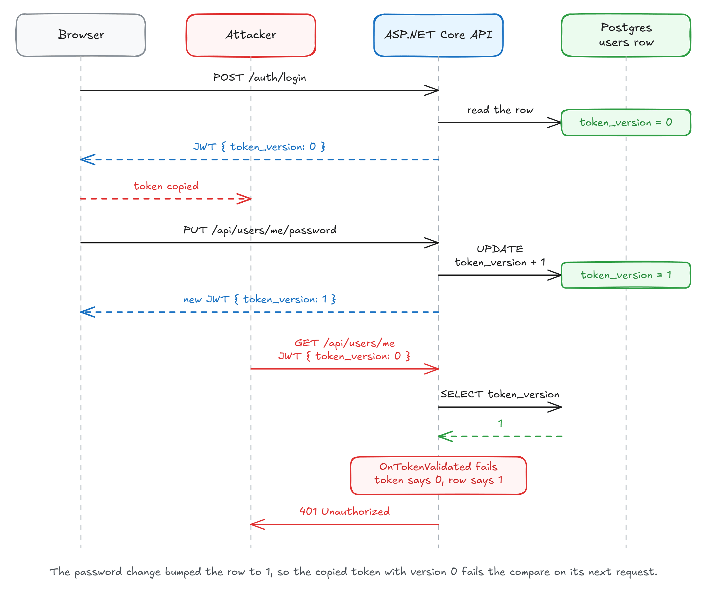

用户改了密码，攻击者手里那份 access token 仍然能调用接口，直到 `exp` 到点。ASP.NET Core 的 JWT bearer handler 只验证签名、issuer、audience 和有效期，不会因为数据库里的密码变了就重新审查这份令牌。

Milan Jovanović 在 2026 年 10 月 24 日发表了[这篇文章](https://milanjovanovic.tech/blog/revoke-jwt-before-it-expires-token-version)，给出两层处理方式：平时用短期 access token 和可轮换的 refresh token，把等待窗口压到几分钟；需要立即失效时，再在每次请求中比较用户表里的 `token_version`。

**大多数应用先做完第一层就够了。只有停用账号、确认令牌泄露、强制下线这类场景不能等几分钟时，才值得打开第二层。**

## `exp` 之前，数据库里的变化与令牌无关

常见的 JWT 配置只负责验证签发者、受众、签名和过期时间：

```csharp
builder.Services
    .AddAuthentication(JwtBearerDefaults.AuthenticationScheme)
    .AddJwtBearer(options =>
    {
        options.TokenValidationParameters = new TokenValidationParameters
        {
            ValidIssuer = "jwt-demo",
            ValidAudience = "jwt-demo",
            IssuerSigningKey = signingKey,
            ClockSkew = TimeSpan.FromSeconds(30)
        };
    });
```

这份配置不会查询用户表。任何拥有验证密钥的 API 实例都能独立完成认证，API 因此不需要共享会话状态，扩容也更简单。代价是签发之后，用户表上的密码、启用状态和权限变化都不会自动写回旧令牌。

`ClockSkew` 还会让接受时间越过 `exp` 一点。上面的配置给了 30 秒余量，所以一个 5 分钟的 access token 失效窗口约为 5 分 30 秒。具体时间还要看客户端什么时候换新令牌，以及网络和时钟误差。

## 先用刷新令牌限制等待时间

第一步是缩短 access token 的有效期，并给每个登录会话配一个单独的 refresh token。示例采用 5 分钟 access token、14 天绝对会话期。refresh token 只存哈希，不存明文：

```csharp
public sealed class RefreshToken
{
    public Guid Id { get; set; }
    public Guid UserId { get; set; }
    public Guid FamilyId { get; set; }
    public string TokenHash { get; set; } = "";
    public DateTimeOffset ExpiresAt { get; set; }
    public DateTimeOffset? UsedAt { get; set; }
    public User User { get; set; } = null!;
}

protected override void OnModelCreating(ModelBuilder modelBuilder)
{
    modelBuilder.Entity<RefreshToken>()
        .HasIndex(token => token.TokenHash)
        .IsUnique();

    modelBuilder.Entity<RefreshToken>()
        .HasIndex(token => token.FamilyId);
}
```

每次登录创建一个新的 `FamilyId`。刷新时，旧 refresh token 被标记为已使用，新 refresh token 加入同一个 family。`ExpiresAt` 从登录时开始算，反复刷新不能延长整个会话的绝对期限。

`TokenService.Hash` 接收的原始值应由 CSPRNG 生成，至少 32 字节，数据库里只保存哈希。原始令牌只在签发响应中出现，之后靠哈希查找记录；不要用用户 ID、时间戳或可猜字符串拼出 refresh token。

刷新接口的关键是一次带条件的原子更新。两个请求同时拿着同一个 refresh token 到达时，只有一个能把它从 `UsedAt == null` 改成当前时间：

```csharp
app.MapPost("/auth/refresh", async (
    RefreshRequest request,
    AppDbContext db,
    TokenService tokens) =>
{
    var hash = TokenService.Hash(request.RefreshToken);
    var stored = await db.RefreshTokens
        .Include(token => token.User)
        .SingleOrDefaultAsync(token => token.TokenHash == hash);

    if (stored is null || stored.ExpiresAt < DateTimeOffset.UtcNow)
    {
        return Results.Unauthorized();
    }

    await using var transaction = await db.Database.BeginTransactionAsync();

    var claimed = await db.RefreshTokens
        .Where(token =>
            token.Id == stored.Id &&
            token.UsedAt == null)
        .ExecuteUpdateAsync(set => set.SetProperty(
            token => token.UsedAt,
            DateTimeOffset.UtcNow));

    if (claimed == 0)
    {
        // 同一个 refresh token 被再次使用，整个登录会话作废。
        await db.RefreshTokens
            .Where(token => token.FamilyId == stored.FamilyId)
            .ExecuteDeleteAsync();

        await transaction.CommitAsync();
        return Results.Unauthorized();
    }

    var session = tokens.CreateSession(
        stored.User,
        db,
        previous: stored);

    await db.SaveChangesAsync();
    await transaction.CommitAsync();

    return Results.Ok(session);
});
```

事务用于包住“认领旧令牌”和“写入新令牌”。如果新令牌写入失败，旧令牌也不能停留在已使用状态，否则客户端下一次正常的刷新会被误判为攻击。

如果启用了后面的 `token_version` 检查，`claimed == 0` 分支还应递增该用户的版本号。否则攻击者已经拿到手的 access token 仍能用到过期，family 删除只封住了续期入口。

检测到重复使用时，服务端无法判断先到的是正常客户端还是攻击者。删除整个 family 会让双方都退出，用户需要重新登录。这是有意造成的安全损失，换来的是攻击者不能继续无限刷新。

两个浏览器标签页同时刷新，也会看起来像重复使用。客户端应把刷新请求合并成一次；例如在页面内用一个共享 Promise 串行化刷新，多个调用方等待同一次结果。不要让每个标签页独立刷新。

这条路径还有一个空窗：只有真实客户端再次刷新时，系统才会发现旧令牌被复用。如果用户合上电脑，攻击者可以一直刷新到 family 的绝对过期时间。需要更早发现时，可以引入 DPoP，把令牌绑定到客户端持有的密钥；令牌副本离开那台设备就无法单独使用。

## 数据库里的版本号决定旧令牌还能不能用

刷新令牌能封住续期入口，但已经签发的 access token 还能活到过期。对泄露处置和紧急停用，这会留下几分钟的窗口。`token_version` 的做法是在用户行上放一个整数，再把它写进 access token：

```csharp
var claims = new List<Claim>
{
    new Claim("sub", user.Id.ToString()),
    new Claim("sid", sessionId.ToString()),
    new Claim("token_version", user.TokenVersion.ToString())
};
```

每次验证 JWT 后，再比较令牌里的版本和用户表中的版本。`OnTokenValidated` 会在签名和过期时间已经通过之后运行，适合放这段自定义检查：



图源：Milan Jovanović 原文中的 token_version 撤销时序图。

```csharp
builder.Services
    .AddAuthentication(JwtBearerDefaults.AuthenticationScheme)
    .AddJwtBearer(options =>
    {
        options.MapInboundClaims = false;
        options.TokenValidationParameters = new TokenValidationParameters
        {
            ValidIssuer = "jwt-demo",
            ValidAudience = "jwt-demo",
            IssuerSigningKey = signingKey,
            ClockSkew = TimeSpan.FromSeconds(30)
        };

        options.Events = new JwtBearerEvents
        {
            OnTokenValidated = async context =>
            {
                var principal = context.Principal;
                var userIdValue = principal?.FindFirstValue("sub");
                var versionValue = principal?.FindFirstValue("token_version");

                if (!Guid.TryParse(userIdValue, out var userId) ||
                    !int.TryParse(versionValue, out var tokenVersion))
                {
                    context.Fail("Invalid session claims.");
                    return;
                }

                var db = context.HttpContext.RequestServices
                    .GetRequiredService<AppDbContext>();

                var user = await db.Users
                    .AsNoTracking()
                    .Where(candidate => candidate.Id == userId)
                    .Select(candidate => new
                    {
                        candidate.IsActive,
                        candidate.TokenVersion
                    })
                    .SingleOrDefaultAsync();

                if (user is null ||
                    !user.IsActive ||
                    user.TokenVersion != tokenVersion)
                {
                    context.Fail("The session is no longer valid.");
                }
            }
        };
    });
```

修改版本号时用一次 SQL 更新，不要先读出来再写回，否则并发请求可能互相覆盖：

```csharp
await db.Users
    .Where(user => user.Id == userId)
    .ExecuteUpdateAsync(set => set.SetProperty(
        user => user.TokenVersion,
        user => user.TokenVersion + 1));
```

`IsActive` 和版本号在同一个查询里读取。账号一旦停用，即使密码没改，下一次请求也会得到 401。启用外部身份提供商时，这条检查还需要考虑：资源服务器能否拿到可信的用户状态；外部 IdP 签发的 token 里通常不能由你的 API 任意追加 `token_version`。

## 单设备登出再检查 `sid`

版本号按用户递增。用户改密码，或者点“退出所有设备”，所有 access token 会一起失效。普通登出只应该结束当前设备，所以每个登录会话还要有独立的 `sid`。

如果只删除当前 family 的 refresh token，access token 仍能活到过期。要让这台设备的 access token 立即失效，在同一查询里确认 family 还存在：

```csharp
var user = await db.Users
    .AsNoTracking()
    .Where(candidate => candidate.Id == userId)
    .Select(candidate => new
    {
        candidate.IsActive,
        candidate.TokenVersion,
        SessionActive = db.RefreshTokens.Any(
            token => token.FamilyId == sessionId)
    })
    .SingleOrDefaultAsync();

if (user is null ||
    !user.IsActive ||
    user.TokenVersion != tokenVersion ||
    !user.SessionActive)
{
    context.Fail("The session is no longer valid.");
}
```

普通登出删除这一个 `FamilyId`。密码修改或“退出所有设备”则删除该用户的全部 refresh token，并递增 `TokenVersion`。前一种操作只打断当前设备，后一种操作覆盖所有设备。

## 每次请求多一次查询

作者用 k6 测了一个不包含其他数据库工作的受保护接口，Postgres 和 Redis 都跑在同一台机器的 Docker Desktop 中。1 用户的数据取三次 60 秒运行的平均值，64 用户的数据各跑一次：

| 并发用户 | 版本检查 | 每秒请求数 | 平均延迟 | p99 延迟 |
| -------- | -------- | ---------: | -------: | -------: |
| 1        | 关闭     |      4,678 |  0.16 ms |  0.63 ms |
| 1        | Postgres |      1,210 |  0.81 ms |  1.78 ms |
| 1        | Redis    |      1,824 |  0.43 ms |  1.12 ms |
| 64       | 关闭     |    160,063 |  0.31 ms |  1.54 ms |
| 64       | Postgres |     20,987 |  2.96 ms | 12.78 ms |
| 64       | Redis    |     76,106 |  0.78 ms |  1.74 ms |

这组数字说明查询成本不能忽略，也说明测试方法与生产环境有明显距离。接口本身没有其他数据库工作，所以它接近最悲观的情况；真实 API 往往早就有别的查询和外部调用。把 160,063 到 20,987 的下降直接套到自己的系统上，会得出错误结论。

Postgres 仍然是权威状态。Redis 被清空或停止时，查询回落到 Postgres，旧令牌仍会得到 401。加入缓存后要处理一个更隐蔽的问题：版本更新成功，但缓存里还留着旧版本，检查会暂时放行已经撤销的令牌。至少要在数据库提交后删除对应缓存，并测试更新与读取并发时的行为；缓存故障时回退到数据库，不能让失效的缓存直接放行。

## 用四个请求验收到位

在一个已经能签发 JWT 的 ASP.NET Core 10 项目中，按下面的顺序验证：

1. 用当前用户签发 access token，请求受保护接口，确认返回 200。
2. 把数据库中的 `TokenVersion` 加一，再用同一个 access token 请求，确认立即返回 401。
3. 用同一个 refresh token 连续调用两次 `/auth/refresh`，第一次应成功，第二次应返回 401；再用第一次拿到的新 refresh token 请求，也应该失败。
4. 为同一用户创建两个 `sid` 不同的会话，只结束其中一个，确认另一个仍能访问。若要求当前设备的 access token 也立刻失效，再把 `sid` 检查加入查询。

如果版本已改但旧 token 仍返回 200，先看三处：令牌里是否真的有 `token_version` 和 `sid`，`OnTokenValidated` 是否被注册到正在使用的 bearer 方案，`MapInboundClaims` 是否让自定义 claim 的名字发生了变化。缓存命中先于数据库查询时，也要确认缓存已被正确失效。

常见的反向误判是刷新接口频繁返回 401。除了攻击者复用令牌，两个标签页同时刷新、客户端重试导致同一请求发送两次，也会走到 family 删除分支。在客户端做单飞刷新，在服务端记录 family 和请求上下文，才能区分正常重试与凭证复用。

## 把即时撤销留到确实需要的接口

短期 access token 加 refresh token 轮换应该先做。它限制泄露窗口，把会话拆成可按设备撤销的 family，也能通过重复使用检测把可疑登录整体踢下线。

只有“几分钟也不能等”的接口再加 `token_version`。这意味着认证开始依赖数据库；如果数据库不可用，这些请求也无法完成认证。接受这个依赖之前，先用真实流量和真实查询组合做一次压测，再决定是否加缓存。

如果系统已经交给成熟的身份提供商，优先使用它提供的会话撤销、轮换和回传通道，少维护一套自己实现的认证状态。需要自己实现时，至少把版本更新、family 删除、缓存失效和客户端刷新合并放进同一套故障测试里。

## 参考

- [How to Revoke a JWT Before It Expires](https://milanjovanovic.tech/blog/revoke-jwt-before-it-expires-token-version)
- [Configure JWT bearer authentication in ASP.NET Core](https://learn.microsoft.com/en-us/aspnet/core/security/authentication/configure-jwt-bearer-authentication?view=aspnetcore-10.0)
- [JwtBearerEvents.OnTokenValidated](https://learn.microsoft.com/en-us/dotnet/api/microsoft.aspnetcore.authentication.jwtbearer.jwtbearerevents.ontokenvalidated?view=aspnetcore-10.0)
- [Refresh Token Rotation](https://auth0.com/docs/secure/tokens/refresh-tokens/refresh-token-rotation)
- [OWASP Session Management Cheat Sheet](https://cheatsheetseries.owasp.org/cheatsheets/Session_Management_Cheat_Sheet.html)
- [RFC 9449: OAuth 2.0 Demonstrating Proof of Possession](https://www.rfc-editor.org/rfc/rfc9449.html)
