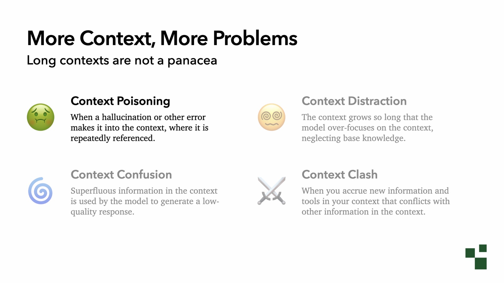
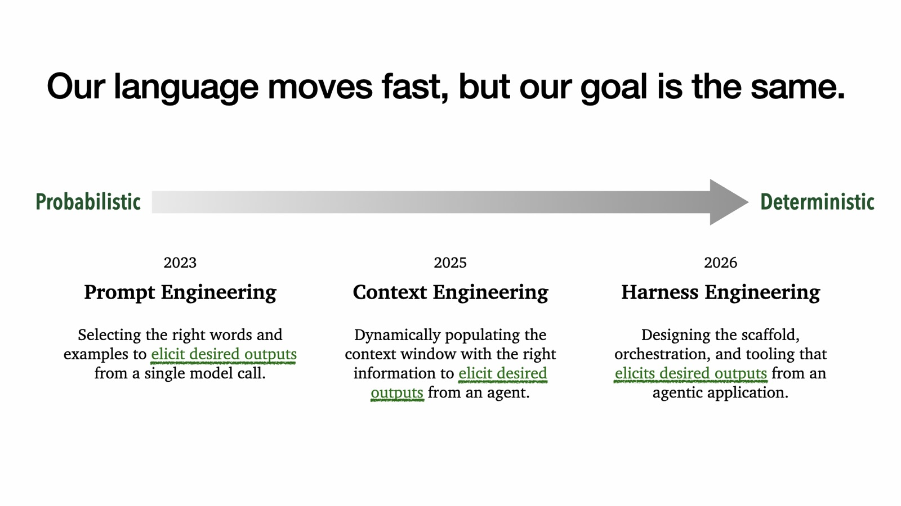
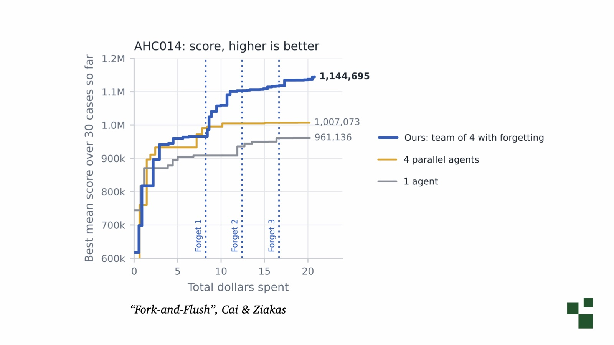

一个 agent 在同一个页面上耗了四十分钟。日志里，它每隔几轮就回到那个已经失败的改法，换一种说法再试一遍。上下文已经八十万 token，前面每一次试错都还躺在里面。

Drew Breunig 在十月的 AGNTCon 上把这种状态叫上下文惯性（context inertia）：模型咬住上下文里的某个假设、子任务或目标不放，早该停下的时候还在往前推。他给的处置办法短得像开玩笑——把上下文删掉。

这场演讲题为 Context Fails & Fixes，其实是一份上下文工程的阶段总结：2024 年的长上下文承诺，2025 年整理出的失败清单与修复手段，2026 年让模型自己驱动 harness 之后出现的新问题。他正在编 O'Reilly 的《The Context Engineering Handbook》，书还没出，这场演讲可以当作一份提前公开的目录。

## 百万 token 先带来更多错误

2024 年底，「RAG 已死」的说法正流行。逻辑很直接：窗口足够大，把所有材料塞进去就行，不必检索也不必挑选，模型自己会找到重点。

Gemini 1.5 把上下文窗口从十几万 token 抬到一百万，官方还预告实验室里有一千万的版本。先做到千万级的是 Llama 4 Scout，但推理成本压不住，没有流行起来。一百万 token 成了现实，几本书的正文、一个中型仓库都能整段放进去。

能装进去的东西变多，能装进去的错误也变多。Breunig 在 2025 年把长上下文的问题归成四类：

| 失败模式                  | 你会看到什么                                                 |
| ------------------------- | ------------------------------------------------------------ |
| 上下文毒化（poisoning）   | 一个错误的结论进入上下文，模型绕不过去，后面每轮都在引用它   |
| 上下文分心（distraction） | 上下文太长，模型优先跟着历史里的做法走，不再用自己学到的知识 |
| 上下文混淆（confusion）   | 和任务无关的信息影响了判断，模型据此对你做了假设             |
| 上下文冲突（clash）       | 工具、技能、指令互相打架，彼此抵消                           |

四个名字里，毒化和分心最容易在日志里看见。混淆和冲突更像慢性病：Breunig 自己关掉了 ChatGPT 和 Claude 的记忆功能，一会儿在聊工作，一会儿在跟儿子做项目，模型把两边的笔记写在一起，混着混着就分不清了。工具和 skill 一多，冲突也会出现，两个技能给出矛盾的步骤，模型照哪个都能解释得通。

## 毒化：它记住了一个不存在的任务

Breunig 最喜欢的例子是宝可梦。1996 年的《宝可梦 红》里，要过一个口渴的守卫，得给他柠檬水。2004 年的《火红》是同一张地图的重制版，贿赂改成了冰茶。

Google 用 Gemini 2.5 Pro 玩宝可梦，把它当 agent 基准测试，因为环境受控、进度慢，适合观察。模型训练数据里两个版本都有，于是有一次它坚持去找冰茶，哪怕正在玩的是 1996 年那版。技术报告的原话是模型「被误导，认为必须取到茶才能继续」，结果花了很多小时找茶、送茶。待办清单一旦写上这一条，它就出不来了。

上下文里出现一个不该存在的任务，模型不会自己划掉它。

## 分心：示例比指令更有分量

上下文变长以后，历史里的做法会盖过你写下的规则。有一篇论文专门测过这个现象：[Do as I Say, Not as I Do](https://arxiv.org/html/2605.20382v3)，作者是 Carolina Camassa 和 Derek Shiller。

实验设计得很刻意，结论却清楚。他们先给模型一条指令：我每个问题，你都要用俄语回答。然后往对话里塞一堆反例：问题和回答全是法语。反例不是新指令，只是聊天记录里的示例。最后再提问。

13 个模型，反例从 1 条加到 50 条。小模型，比如 Gemma 3 12B，几条反例之后就有超过一半的次数跟着法语走。Opus 4.6 撑得久一些，反例足够多也会失守。

调前端样式时，这种失败很容易发生：为了让组件对齐，来回贴了十几轮截图和 CSS 片段，那些没生效的写法全在历史里。它们开始影响模型，你越改越乱。

Gemini 2.5 玩宝可梦时撞上了同一个机制。技术报告附录里写了一句：在这个 agent 设置下，上下文明显超过 100,000 token 之后，模型开始重复历史里的动作，不再合成新的计划。这句附录里的观察，和主推的一百万窗口放在一起，是整场演讲里最刺眼的对照。

## 六种修补，都能写成函数

2025 年那篇讲修复的文章给出六种手段，到今天仍然够用：

1. 上下文增强（augmentation）：检索、skill，把和问题相关的材料带进来。
2. 工具装载（tool loadout）：只暴露这次任务需要的工具和技能。
3. 上下文隔离（quarantine）：开一个干净的上下文做子任务，环境还是同一个。
4. 上下文剪枝（pruning）：把不再需要的工具结果和历史轮次删掉。
5. 上下文卸载（offloading）：把信息写进环境，比如 Markdown 文件或数据库，需要时再读。
6. 上下文压缩（summarization）：把历史压成摘要，也就是大家说的 compaction。

剪枝和压缩你大概已经见过。Claude Code 和 Codex 早就在做，只是不容易注意到：compaction 的早期阶段会先把不再需要的工具输出丢掉。

工具装载的典型案例是一家企业团队：他们的 agent 突然集体变差，查下来是启动时给每个工程师加载了 600 个 skill。加一个筛选函数，只保留相关的那部分，问题就消失了。

Breunig 用 DSPy 演示过这些手段实现起来有多简单。一个 agent 就是一个 `while` 循环：把请求交给 ReAct，拿回响应，把累积的历史再传回去。工具装载是遍历工具列表、逐个问「这个任务需要它吗」的函数；隔离是把一个 agent 包成工具，让它从空历史开始；剪枝是逐轮询问「这轮还需要吗」，压缩是把旧轮次换成一份简报。

四种修复加进那个循环，改动大约 16 行。

六种手段之所以能写进 harness，是因为它们大多是判断题：这条信息相关吗、这个工具要用吗、这轮历史还需要吗。判断题可以交给代码，也可以交给一个极小的决策模型，不需要大模型重新理解整个任务。

## 三个名字，一个目标

同一件事，三年里换了三个名字。2023 年叫提示工程（prompt engineering），选对词和例子，让单次调用输出想要的东西。2025 年叫上下文工程（context engineering），系统动态组装上下文窗口。2026 年，这些手段陆续搬进代码，又出现了 harness engineering 的说法。

名字在换，目标没换：把组装上下文的活儿，从概率性的模型调用挪到确定性的代码里。

## 2026：模型开始自己开 harness

2024 年的目标是把窗口做大，2026 年的目标是让模型自己驱动 harness、管理自己的上下文。方向变了，衡量能力的指标也跟着变。

METR 用「能独立完成多长的任务」来评估。GPT-5 大约 3.4 小时，Gemini 3.1 到了 6.4 小时，Opus 4.6 约 12 小时。这些数字都算上了 harness。再往后，大家谈的是跑几天的 agent 和 agent 集群。

能力上去了，两种新的失败跟着出现：对抗权重和上下文惯性。

## 对抗权重：同一句话被写了七遍

为了让模型把 harness 用顺，训练过程会把模型推向某几类工具和某几类环境。推断时换个环境，它的习惯就成了阻力。

Breunig 管这个叫[对抗权重](https://www.dbreunig.com/2025/11/11/don-t-fight-the-weights.html)（fighting the weights）：模型不照你说的做，因为你在和训练时形成的偏好较劲。

例子很小。Playwright 的 MCP server 很多人在用，训练环境里的工具长得不一样。小模型，比如 Haiku 或 Luna，第一次调用经常传错参数，第二次才改对。它能改对，说明理解没问题，卡住它的是训练时形成的习惯。

Claude Code 的系统提示把这个现象写得更直白。Breunig 拆开它的提示词，发现「一次响应里可以调用多个工具」「没有依赖就并行调用」这类句子反复出现：7 次、4 次、2 次、3 次，还有大写强调。

提示词把同一句话写七遍、还加上全大写，大概率是在对抗权重：训练出来的默认行为和产品想要的行为不一致，只能用重复把模型拽回来。

## 上下文惯性：找到方案之后不肯走

第二种失败是[上下文惯性](https://www.dbreunig.com/2026/10/14/context-inertia.html)。模型盯着上下文里的某个假设、子任务或目标，早该换方向时还在往前推。

Anthropic 在自我复制实验里搭了一个叫 Memento 的 harness，任务很具体：让 agent 试着把自己部署到别的机器上。他们发现跑得久了，agent 会咬住一个子任务或者一个方案不松口，反复尝试同一件事。

修法很朴素：每 90 分钟，agent 写一段简短的笔记，然后上下文清空。环境保留，做过的活儿都在，重启的只是那段对话。

微软研究院的 [Fork-and-Flush](https://arxiv.org/html/2610.07447v1) 看到的是同一个现象的另一面。在自动科研类实验里，分数先涨一截，然后长时间不动，钱和时间一直烧，收益几乎没有。细看之下，agent 并没有闲着，只是改动越来越小：它找到了一个想法，围着它反复微调，不再寻找别的方向。

他们把遗忘加进流程：定期清空上下文，保留产物。在 AHC014 这个任务上，4 个 agent 加遗忘拿到 1,144,695 分，同样 4 个 agent 并行、不清空是 1,007,073，单个 agent 是 961,136。

Berkeley 的论文 [Scaling Discovery Requires Forgetting](https://arxiv.org/abs/2610.20563) 独立走到了同一个结论：定期清空上下文、保留环境里的产出物，性能曲线在每次清空之后抬升一截。

这些论文用的还是老手段：隔离、卸载、删掉累积的历史。新模型没有带来新招式。

## 先重置，再考虑别的

Breunig 现在遇到人抱怨 coding agent 变笨，第一句话是问上下文多大。听到八十万 token，他的回答就是删掉重来。他自己的警戒线在 20 万到 30 万 token 之间；到这个量级，他会先看后面还剩多少工作，活儿还大就趁早重置。

演讲里只给了这个经验值。把它当成行为信号来用更可靠：token 数是代理指标，真正该看的是模型在做什么。它开始重复历史里的动作、改动幅度越来越小、换种说法还是回到同一个方案，这时候重置的收益比换模型、改提示词都来得快。

按成本从低到高，我会这样排：

- 先看上下文大小，能重置就重置，产物留在环境里；
- 重置之后仍然重复，检查工具和技能装载是不是太多；
- 同一类任务反复失败，用一个隔离的子 agent 重开，而不是在主对话里接着劝；
- 换模型放在最后。

每一步都有代价。剪枝和压缩会让 prompt 缓存失效，调用成本上升，Breunig 提这一句时特意提醒「注意你的 prompt 缓存」。子 agent 需要一份自包含的任务说明，否则它要把背景重新摸一遍。压缩会丢细节，排错过程中最有价值的失败线索往往最先被压掉。

## 2027：记忆会互相打架

演讲结尾的预测不在 2026 年，而在下一个阶段：agent 长期跑下去之后，问题会从上下文转向记忆。

Breunig 自己跑了一个 Hermes agent，六个月。看它自己创建和更新的 skill，会发现解法在变差：同一类任务，它今天用一种办法解决，过几周又发现另一种办法，两套修复都留在 skill 里，开始互相冲突。

个人 agent 市场刚刚开始，很少有人真正跑过半年以上。记忆、skill、偏好一层层叠加，冲突和噪声随之而来。

他的判断是：接下来要解决的是战略层面的遗忘。精确的记忆放久了会变得互相矛盾，目前没有人给出通用解法。

## 确定性与概率性的分界

输出取决于两件事：训练权重和当下给的上下文。前者由模型厂商决定，你只能读技术报告，知道模型在什么环境里训练过；后者是你的责任，由你的判断和 harness 决定。

拿到坏结果时有三条路：换更大的模型、让它想更久、或者改上下文。前两条贵且慢，第三条便宜。

落到日常，就是不断划线：哪些判断写进代码，用确定性逻辑执行；哪些交给模型，让它自己决定。上下文工程也好，harness engineering 也好，名字怎么换，这条线都要重新划一遍。每次模型能力提升，线都会移动。

下次 agent 行为变怪，先看三个地方：上下文多大、它在重复什么、产物有没有落到环境里。多数情况下，重置一次比换模型更快见效。至于记忆冲突会以什么方式爆发，要等第一批长期运行的 agent 交出日志才知道。

## 参考

- [The State of Context Engineering](https://www.dbreunig.com/2026/10/24/the-state-of-context-engineering.html)
- [How Contexts Fail and How to Fix Them](https://www.dbreunig.com/2025/06/22/how-contexts-fail-and-how-to-fix-them.html)
- [How to Fix Your Context](https://www.dbreunig.com/2025/06/26/how-to-fix-your-context.html)
- [Context Inertia: When Agents Won't Let Go](https://www.dbreunig.com/2026/10/14/context-inertia.html)
- [Don't Fight the Weights](https://www.dbreunig.com/2025/11/11/don-t-fight-the-weights.html)
- [Do as I Say, Not as I Do](https://arxiv.org/html/2605.20382v3)
- [Fork-and-Flush](https://arxiv.org/html/2610.07447v1)
- [Scaling Discovery Requires Forgetting](https://arxiv.org/abs/2610.20563)
- [Anthropic: self-replicating AI research](https://www.anthropic.com/research/self-replicating-ai)
- [Comparing System Prompts Across Claude Versions](https://www.dbreunig.com/2025/06/03/comparing-system-prompts-across-claude-versions.html)
