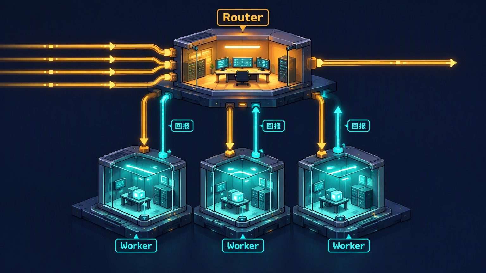

一个人同时盯着五个 agent 会话：第二个窗口里定下的方案，第三个窗口不知道；切过去要重新解释背景，切回来又忘了刚才的结论。模型越强，这件事越不像瓶颈——卡住产能的是人，一人能稳定跟住的会话数，原文给的经验值是 3 到 5 个。

DeepSeek Harness 团队 11 月 1 日在 X 上发了篇长文，讲他们怎么把这个瓶颈从人身上挪走。他们的判断是：会话这个东西不该由用户来管，应该沉成系统的内部实现。围绕这个判断，他们拼出五个模块——两级架构、事件驱动、全双工多通道、计算/状态/环境分离、Watchdog，把这类系统叫 Super-agent。顺带一句背景：DeepSeek Harness 是 DeepSeek 开源的 agent harness，官网称它基于 Cordis 的「一切皆插件」架构，可以当桌面应用跑，也能从代码启动 Web UI。文末给了初步实验：消融对照里任务完成时间 p50 12.4 分钟，单会话方案 20.4 分钟。作者同时写明，实验用的是合成负载、环境也做了简化，数据只作参考。

原文注明是中文原文的机器翻译，下面按英文版整理，专有名词保留英文。有一点要先说清楚：**这篇讲的是架构设想，并不是 DeepSeek Harness 已有功能的介绍**。

## 四个特性，一个 ReAct 循环凑不齐

原文给 Super-agent 定了四个词：Continuous、Productive、Proactive、Persistent。

- Continuous：用户在自己平时工作的地方（IM、GitHub 评论）直接对话，始终感觉在跟同一个 agent 说话，不用关心「某个信息在哪个会话里」。
- Productive：响应快，能并行推进多个复杂任务，上一个命令还没结束就能接下一个指令。
- Proactive：不等逐步指令，自己盯环境里的事件，值得处理的才动手，其他时候保持安静。
- Persistent：一直在线的同时，连着用户真实的工作环境，长跑中出异常能自己恢复。

四个特性里没有一个能靠单个 ReAct 循环做出来，尤其 Proactive 和 Persistent——循环本身是被动等待输入的。这是全文的立论基础：要凑齐这四个，改动得发生在循环外面的系统结构上。

## 两级架构：Router 只派活，Worker 只干活

先看取舍。所有事件都进同一个会话，上下文最连续，但这个会话一次只能跑一步，吞吐上不去，不同任务的中间细节还会挤在同一个上下文里互相干扰。反过来，每个事件开一个新会话，吞吐上去了，上下文断了，几个会话分别回话也会让用户混乱。

两级架构把这两件事拆开：

- **Router 层**：一个长期存在的全局路由层，接管所有人类交互和跨任务协调，是系统的全局序列点、协调点和记忆。为了不让这个单点变成瓶颈，它被设计成不执行任务，只跟人交互、派发任务，甚至可以完全没有 Bash 工具。
- **Worker 层**：每个 Worker 上下文隔离、工具齐全，专职一个任务，通常要用最强的模型。它们不直接跟人说话，只把状态汇报给 Router，由 Router 统一回复。

这跟常见的 Agent Team 结构长得很像，但重点不同。Agent Team 通常是把一个复杂任务拆成步骤、协调不同角色，因为步骤耦合紧，Team Lead 得深入理解任务、频繁协调，推理负担很重。这里的 Router 只派发、只在高层次跟踪任务之间的关系，不拆解单个任务。原文也提到，Agent Team 可以改造成两级架构：只要用提示词把主会话限制在「只做外部交互和派发」，不让它自己执行就行。他们的经验是 Router 的活比想象中简单，用轻一点的模型就够。

Router 会不会成为吞吐瓶颈？他们用一个机制解释：推理回合中到达的环境事件会排队，合并进下一次 LLM 调用，也就是 batching。Router 的每一步通常是长输入、短输出，合并后的事件在 Prefill 阶段并行计算，所以单请求时间涨得比批量慢；在上下文长度和模型处理能力允许的范围内，积压越多，单次决策的摊销时间反而越低。真到了单会话扛不住的那天，再考虑多级过滤或水平分片，代价同样落在连续性和吞吐的取舍上。

## 事件驱动：先过滤，再路由

Super-agent 的主要输入从「人一句句敲的提示」变成半结构化的环境事件：群消息、邮件、日程提醒、代码评审评论、CI 结果，原文统称 Triggers。有了 Triggers，agent 不必等指令才动。

真实的事件流噪音极大，绝大多数消息不需要 agent 做任何事。让大模型逐条判断，延迟和算力都浪费。他们借了计算机系统的 Fast Path / Slow Path：

- 程序化策略（Fast Path）：用代码做确定性过滤——来源、群组、用户或机器人白名单，每个来源可以设成「只回应显式请求」「当作候选事件」「忽略」。
- 语义策略（Slow Path）：过了程序化检查的候选事件才交给模型，由它结合上下文和提示词里写的策略决定要不要动手。

路由也分两档。同一 PR、同一 IM 话题、同一邮件链上连续的事件会形成一条 Thread。Router 为 Thread 的第一个事件创建 Worker 时，让这个 Worker 直接订阅该 Thread；之后同 Thread 的后续事件由代码直接透传给订阅者（subscription and pass-through），不再经过 Router 转发。Router 仍然能看到全部事件，用来维持全局状态，但它只评估和派发那些还没有订阅者的新事件。

订阅关系是多对多的：一个 Worker 可以订阅多条 Thread，一条 Thread 也可以有多个订阅者。几个 Worker 在同一环境里重叠时，同一条事件会同时送到所有订阅者手上，它们自己发现冲突并解决，不需要点对点通信。

## 把上下文窗口当缓存

事件送到会话之后，下一个问题是一次放多少信息进去。放太多，窗口被填满，模型注意力被稀释；放太少，模型要反复调工具去读，执行步数暴涨。原文的说法很直接：浪费上下文窗口就是浪费模型的智力。

他们把这当成缓存来管，基本操作只有两个。Inline：把大概率马上要用的信息直接放进当前窗口，省掉一次工具往返。Spill：内容超出预算或者很少用到时，把完整内容留在窗口外，窗口里只留引用或摘要，模型需要时再按引用去读。

配合局部性（locality），注入可以分步做：先给当前对象的 ID 和内容摘要；再按空间或时间上的邻近关系逐步 Inline，比如内容的前 50 个字符、一条消息前后的群聊上下文、代码评审里相邻的评论；超过长度上限的长内容截断后 Spill，留一个指向剩余内容的指针。

Router 自己也有同样的问题：后续事件大量直接透传给 Worker，过去任务的记录又越积越多，它不可能把每个任务的历史都留在窗口里。把 Inline/Spill 统一用到系统里每类对象上，就得到按需、多跳的检索机制 Chain of Recall：Triggers、Threads、Worker Sessions 都有唯一 ID，注入某个对象时顺带 inline 它近邻对象的 ID，这些 ID 把对象连成引用图；每次通过工具召回的对象同样遵守 Inline/Spill，返回结果里带上下一跳对象的摘要和 ID。模型从当前事件出发，顺着引用一跳跳扩展，需要多深就拉多深。

## 全双工：工具调用不再堵住对话

经典 ReAct 循环里，模型调一个同步的 `run()` 工具，循环要等工具跑完返回最终结果，这期间会话收不了新消息。改法是异步：把耗时的命令和工具调用换成 `start()` / `stop()`，`start()` 立刻返回「Started」，循环不等；工具在后台结束后，把最终结果作为一条新事件消息送回会话；模型也可以根据上下文调 `stop()` 结束跑太久的后台命令。前台对话和后台任务就此解耦。

原文在这里交代了一句现状：DeepSeek Harness 已经实现了这套异步任务机制，但默认没有开启。

多通道是另一半。群聊、邮件、GitHub 讨论的沟通方式不同，回复的详细程度和语气要跟着变：终端里适合贴详细的推理和工具日志，原样贴进群聊就是刷屏。两级架构已经解决了一部分——每个任务的冗长推理和频繁工具调用留在 Worker 里，不直接出现在外部通道，Router 负责对外。除此之外，还要按通道定规矩。他们有两条：IM 里保持轻量、尽量不打扰人，只在需要决策或签收时通知，只问直接的问题，只给短结论，一条验证过的硬规则是每次回复不超过 100 词；GitHub、邮件、文档这类异步通道则给结构化、信息密度高的产出，比如按项目惯例写清问题背景、改动说明和验证结果。

## 计算、状态、环境拆成三块

本地 agent 默认把三样东西绑在一台设备上：跑 Agent Loop 的计算、需要持久化的会话状态、以及代码仓库和本地工具链这类执行环境。设备一休眠或离线，agent 就停；它也没法用别的设备上的环境。

他们借计算存储分离，分两步拆。第一步，把 Agent Loop 跑在无状态、可弹性伸缩的云容器里，会话和其他持久状态放数据库，容器可以扩缩、重启、替换，状态还在，设备睡不睡都不影响 agent 在线。第二步，把云上的 Agent Loop 和状态很重的执行环境解耦：不必把环境搬到云上重建，只要每个端点装一个轻量 daemon，它不保存会话状态，只执行命令、回传结果；环境留在原地，agent 按需去读。

Anthropic 的 “Scaling Managed Agents with stable interfaces” 走的是同一条路，其中 “Decouple the brain from the hands” 一节讲的就是这个：harness 无状态、session 日志外置、执行环境按需连接。差别在场景——Anthropic 讲的是托管服务，主要处理按需创建的沙箱和 VPC 内资源；他们要接的是开发者每天用的个人机器，上面有没提交的改动、本地凭据，还可能只是偶尔在线。所以他们的设计支持 BYOM（Bring Your Own Machine，原文自创的窄义用法，和常见的“Bring Your Own Model”不是一回事），也能接云端机器和按需创建的计算环境。

Persistent 还差一块：自主恢复。只用内部逻辑的分布式系统很难长期可靠，所以需要一个外部 Control Loop。他们的 Watchdog 是跑在主系统之外的独立会话，由定时消息驱动，处理 API 报错、状态恢复失败这类基础设施故障；更关键的是它会用模型判断每个 Worker 是在实质推进还是偏离了目标，因为很多异常不是崩溃——进程还活着，模型却卡在无产出的循环里。Watchdog 自己带着完整工具，维护者可以用自然语言问它为什么失败，也可以让它在系统运行时改行为，比如增删提示词、调整触发规则。

## 实验数字与它们不能证明的事

消融实验同时跑四种设计，输入是一串群消息和 GitHub CI 消息：每次约 300 条消息，其中约 20 条是工作任务，其余是闲聊、追问、取消和 CI 消息。编码工作由一个只消耗时间的工具模拟，所以实验测的是调度与协调，不是单个任务的执行能力。每种设计跑 5 次。四种设计是：Super-agent、去掉 pass-through 的 Super-agent、带 subagent 工具的单会话（中立提示词）、带 subagent 工具的单会话（委派优先提示词）。

| 设计                              | 完成时间 p50 / p95（分钟） | 每次运行 cache-read tokens |
| --------------------------------- | -------------------------- | -------------------------- |
| Super-agent                       | 12.4 / 15.7                | 23.2M                      |
| Super-agent（去掉 pass-through）  | 12.6 / 15.5                | 31.8M                      |
| 单会话 + subagent，中立提示词     | 20.4 / 29.5                | 6.1M                       |
| 单会话 + subagent，委派优先提示词 | 13.8 / 29.0                | 10.8M                      |

几个值得注意的细节：

- 单会话方案强烈依赖提示词。中立提示词下，5 次运行里模型一次都没调用 subagent，全部工作挤在主会话里被新消息打断，p95 冲到 29.5 分钟；换成委派优先提示词，5 次里有 4 次委派了，时间下降但不稳定——剩下那次模型觉得任务「很小」自己做了，就是图里那条紫色长尾。
- Super-agent 的会话多，cache-read tokens 比单会话高得多，是用 token 换更短、更稳的完成时间。
- 去掉 pass-through 后完成时间几乎不变，但 Router 每次运行多做约 30% 的决策，总 cache-read tokens 从 23.2M 涨到 31.8M，多了约 37%。在这个负载下，pass-through 不加快任务，但明显省 Router 的 token 和推理开销。

第二个实验单独压测 Router 层：Router 调真模型，Worker 用 mock，把需要决策的 Trigger 到达率从每分钟约 1 次逐步提到约 40 次。平均批量从 1.0 涨到 2.8，单请求时间只从 2.5 秒涨到 3.9 秒，于是每次决策的摊销推理时间从 6.4 秒降到 1.6 秒。他们由此判断：以当前团队规模，没必要为了吞吐提前分片 Router，牺牲全局上下文的连续性不划算。

这些数不能直接搬到别的系统上。原文自己写了，实验用合成负载、简化环境，部分设置还不够严谨，结果「只作参考」；编码还被替换成了纯耗时工具。能带走的是机制层面的判断——两级分工把「谁做什么」写进了系统，而不是靠提示词和模型临场发挥；pass-through 省的是 Router 的 token；batching 让单会话 Router 比直觉更抗压。

## 他们承认没解决的四个问题

- **扩展**：任务更大、耦合更紧时，Router 该不该分片、分多细，Worker 之间什么时候该直接通信、用什么拓扑，都还没有定论；系统跑几个月后，长期记忆会成为主要瓶颈。
- **没有会话的交互**：会话沉到系统内部之后，任务该怎么呈现给用户、怎么做项目管理，都变成开放的产品问题。聊天窗口的中心地位部分是路径依赖——他们的实例已经直接在 GitHub Issues 和 PR 里工作。
- **上下文边界与 A2A**：给一个组织配几个 Super-agent，等于在决定哪些上下文共享、哪些隔离；跨实例协作就是跨权限边界的 agent 通信，怎么安全可靠地做还没答案。
- **安全与隐私**：事件驱动让更多不可信输入能驱动 agent；云上 Agent Loop 和端点互信的前提，一旦被服务端入侵或提示注入打破，所有连着的端点都可能被接管。凭据也是——只要端点上的凭据能进模型上下文，正常执行就可能泄露，agent 需要一种「能用但看不到」凭据的方式。

## 对做 agent 的团队，哪些可以先抄

整套系统很重，但里面有几条是可以单独拿走的：

1. **让主会话只派活、不执行**。哪怕还在用单会话，也可以先用 subagent 把执行挪出去，主会话只负责人和协调。这是两级架构最便宜的那一半，实验也说明它能显著缩短完成时间并压住 p95。
2. **事件先进代码过滤，再进模型**。来源白名单、只响应显式请求这类规则用程序写死，省下的不是算力，是每一轮判断的延迟。
3. **把上下文当缓存**。对象先给 ID 和摘要，长内容留在外面留指针，模型需要时再按引用去读。这套做法在单 agent 里同样成立。
4. **工具调用异步化**。同步 `run()` 会把整个对话堵住，改成 `start()` 加事件回传，会话才能在你盯着的同时继续接指令。
5. **给系统配一个外部 Watchdog**。进程存活探针看不出「agent 在空转」和「偏离目标」，需要一个独立的循环用模型判断进展。

原文最后也把话说得很清楚：这篇讲的是架构思路，不提出新理论；实现会变，设计思路的寿命更长。文中提到的插件是个面向单个 GitHub 仓库的 coding agent，打包成 DeepSeek Harness 插件，MIT 许可；它的 README 写明这是研究原型、不是官方产品，和文章描述的内部实现并不完全一致，有些设计只是未来方向、原型里没有实现。

如果现在只有一个会话，最小的改动是先做第 1 条：把执行从主会话挪到隔离的子会话，主会话只留派发和汇报。等真的需要常驻和并发，再补事件驱动和状态分离这两块。

## 参考

- [Exploring Super-agent Design: Towards a More Autonomous Agent System（X 长文）](https://x.com/DeepSeekHarness/status/2116857257245987236)
- [dsh-superagent-prototype（原型插件）](https://github.com/deepseek-ai/dsh-superagent-prototype)
- [Anthropic：Scaling Managed Agents with stable interfaces](https://www.anthropic.com/research/managed-agents)
