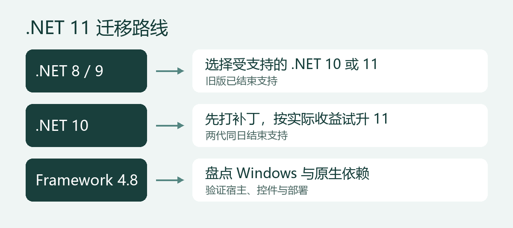

如果选课服务已经跑在 .NET 10，升级到 .NET 11 可以带来 C# 15、异步验证和新的 OpenAPI 生成能力，但两代的支持终点都是 **2028 年 11 月 14 日**。先给现有服务打最新补丁，再用一个真实需求判断是否值得排迁移窗口。还在用 .NET 8 或 9 的服务优先迁移，两者已于 2026 年 11 月 10 日结束支持。

.NET 11 同日发布，首发 SDK 为 `11.0.100`，应用项目使用 `net11.0` 时默认采用 C# 15。下面的路线适用于现代 .NET 应用和仍在维护的 .NET Framework 4.8 应用。前一类可以从构建、契约和部署验证开始，后一类要先盘点 Windows 依赖、宿主和第三方组件。

## 现有服务从哪条路走

| 现有目标           | 优先动作                                           | 进入下一阶段前要拿到的证据                                              |
| ------------------ | -------------------------------------------------- | ----------------------------------------------------------------------- |
| .NET 8 / 9         | 选择仍受支持的 .NET 10 LTS 或 .NET 11 STS          | 包能恢复，应用能在目标机器启动，关键接口和数据写入通过回归              |
| .NET 10            | 保持补丁更新，挑一个需要 .NET 11 的工作负载试升    | 有具体收益，客户端和数据库兼容，旧镜像能恢复                            |
| .NET Framework 4.8 | 先列出 System.Web、COM、混合模式程序集和第三方控件 | 逐个验证替代方案，确认仍在使用的 Windows 版本和 .NET Framework 支持状态 |

例如，已有 Angular 前端的 API 如果准备采用异步模型验证，第一步可以保存当前 OpenAPI 文档和生成客户端的版本。然后用 .NET 11 生成同一个 API 的文档，用原生成器重新生成客户端。若它读不了 3.2，可以先显式生成兼容格式，保持前端工具链单独演进。

## 哪些变化会碰到项目

| 层     | 正式版可使用的变化                                             | 需要额外确认的条件                                        |
| ------ | -------------------------------------------------------------- | --------------------------------------------------------- |
| 语言   | C# 15 union、closed 层级、集合表达式参数；F# 11 record spreads | C# Memory Safety 仍在预览，F# 功能按 SDK 所带编译器核对   |
| 运行时 | JIT 的边界检查消除和去虚拟化、Native AOT 接口分派改进          | 项目自己的 Runtime Async 需显式开启；x86/x64 需 x86-64-v2 |
| Web    | Minimal API 异步验证、默认 OpenAPI 3.2、SignalR 认证刷新       | 重新生成客户端；验证 SSE、状态码和错误体                  |
| 数据   | EF Core 11 改进查询翻译，部分关系型 provider 可翻译 `FullJoin` | 核对实际 provider 版本、生成 SQL 和数据库执行计划         |
| 基础库 | JSON Lines、内存流、进程帮助器、Zstandard                      | 比对现有协议和失败路径后逐个替换                          |
| 工具链 | Native AOT CLI 宿主、常驻 MSBuild Server、容器构建选项         | `dotnet test` 的平台不同，支持的参数也不同                |
| 客户端 | Windows 桌面改进、MAUI 默认 CoreCLR                            | 检查目标 OS、MAUI workload、设备与原生依赖                |

x86-64-v2 是处理器指令集基线。部署在虚拟机里的服务要在目标实例上验证，宿主 CPU 型号只提供部分信息。MAUI Android Native AOT 和 Blazor AI 组件目前适合隔离试验，生产升级可以暂时沿用已有运行模式。

## 留下第一份对照

在现有分支上记录 `dotnet --info`、`dotnet list package --include-transitive`、OpenAPI JSON、容器摘要以及一组成功和失败请求。用单独分支改 SDK 与 TFM，然后用同一批请求回放。选课服务至少要覆盖成功、课程缺失、重复报名和权限过期，查询性能还需要同一份数据和查询参数。

开发机上的编译只是最早的检查。在最旧的 CI runner、测试 VM 以及实际容器基础镜像上分别启动；遇到 CPU、原生依赖或 provider 问题时，保持旧运行时与原配置可用，并将改动缩回到已验证的层。

后续实操可以从 Web 契约和部署流程开始。[Angular 契约检查](/posts/aspnet-core-11-openapi-angular/) · [服务升级与灰度](/posts/dotnet-10-to-11-rollout/)

## 参考

- [微软 .NET 11 正式发布](https://devblogs.microsoft.com/dotnet/announcing-dotnet-11/)
- [.NET 支持策略与版本表](https://dotnet.microsoft.com/en-us/platform/support/policy/dotnet-core)
- [.NET 11 功能总览](https://learn.microsoft.com/en-us/dotnet/core/whats-new/dotnet-11/overview)
- [.NET 11 运行时与最低硬件要求](https://learn.microsoft.com/en-us/dotnet/core/whats-new/dotnet-11/runtime)
- [.NET 11 破坏性变更](https://learn.microsoft.com/en-us/dotnet/core/compatibility/11)
- [.NET Framework 支持策略](https://dotnet.microsoft.com/en-us/platform/support/policy/dotnet-framework)
